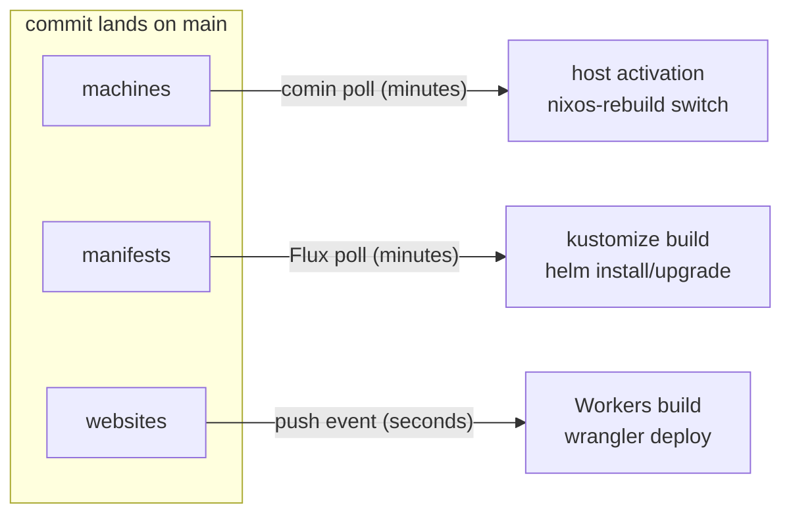
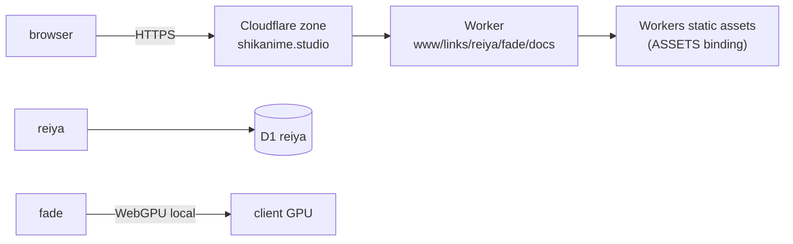
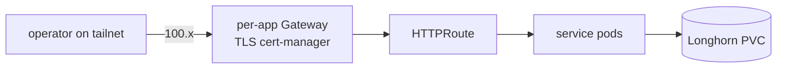
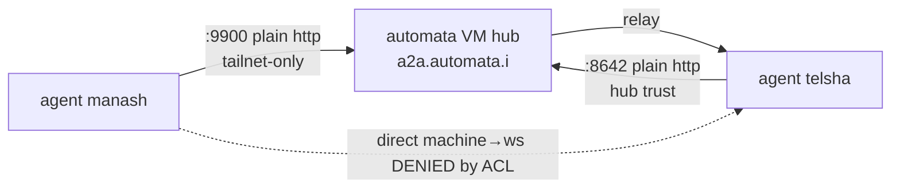
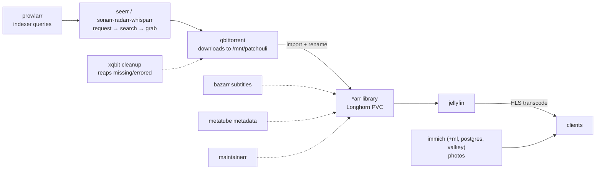
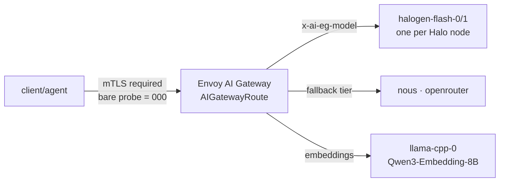
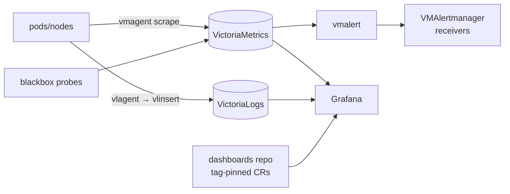
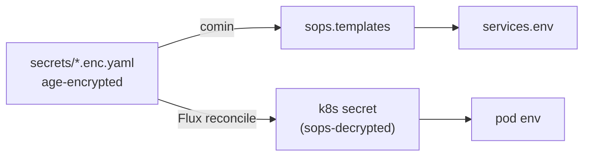

# Dataflow

How bytes actually move: commits to running systems, requests to
services, metrics to dashboards, prompts to tokens.

## Git → runtime: reconciliation

Each path is pull-based except the edge: hosts and the cluster poll
Git, so a partitioned node converges the moment it reconnects. The
edge is push-triggered but immutable per deployment.

## User request paths

**Public web for anonymous users:**

- The static-heavy apps www, links, and docs serve from the ASSETS
  binding. The Worker is a thin shell.
- fade does its heavy lifting **client-side**: files never leave the
  machine. EXIF and RAF parsing, demosaic, and rendering run in WebGPU
  shaders and in Web Workers from the darkroom package.
- reiya is the only main-branch app with a database, D1 `reiya`,
  reached through drizzle-orm.

**Tailnet service for the operator:**

**Agent mesh over A2A:**

## Media pipeline: servarr

- Indexing: prowlarr feeds the *arr apps tracker results.
- Acquisition: qbittorrent downloads. The xqbit job,
  `qbittorrent-cleanup`, reaps `missingFiles` and resumes recoverable
  errored torrents.
- Organization: the *arr apps import, rename, and manage the library;
  bazarr/metatube/maintainerr attach subtitles, metadata, and cleanup.
- Consumption: jellyfin streams, with transcoding on the x86 nodes.
  immich serves photos with ML tagging from its own model pod.

## Inference path: prompt → tokens

Model selection is the x-ai-eg-model header; each route is a backend
chain with remote-provider fallback tiers. The binding constraint is the
Halo unified GTT pool shared between weights and KV cache — full story
in [AI infrastructure](../services/ai-infrastructure).

## Observability path: signal → dashboard

## Secret flow: sops

Secrets are never stored plaintext anywhere except the target's memory
at activation time; rotation = re-encrypt + commit + reconcile.
