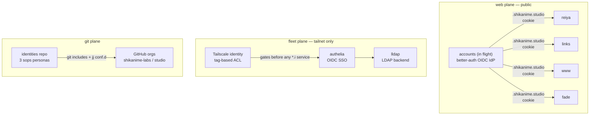

# Fleet identity

Two identity systems with different trust roots. The **web mesh** is
public and runs better-auth. The **fleet plane** is tailnet-only and
runs Authelia + LLDAP + sops. They never share a root of trust by
design.

## Git plane: the identities repo

Three personas, each a sops-encrypted record holding name, email, and
signing keys. Each record renders **only per-tool fragments** — git
includes, jj `conf.d/*.toml`, ghstack/glab config. The modules
deliberately do not enable git/jj themselves; they just inject
identity into whatever already manages the tool.

- `shikanime` — primary studio identity (GitHub/GitLab tokens,
  ghstack)
- `gouv` — government work, path-scoped via
  `git.condition gitpath:` to cloud-pi-native repos
- `automata` — the YoRHa operator persona; owns the A2A hub. Commits
  that used the automata agent or the inference infrastructure carry
  the trailer `Co-authored-by: Automata <automata@shikanime.studio>`

SSH signing is fixed in-module: every commit from any persona is a
signed commit and shows a verified badge on GitHub. The
protected-`main` rulesets enforce this as well.

## Fleet plane: Authelia + LLDAP

- **LLDAP** is the lightweight directory; admin runs via GraphQL on
  port 17170, reached through a port-forward of `svc/lldap`. Users
  and groups live here.
- **Authelia** fronts it as the OIDC SSO for every `*.i.shikanime.studio`
  service that needs a login, such as Grafana and Forgejo.
- Cluster workloads register as Authelia OIDC clients. Each app
  carries its own client credentials in sops.

## Tailnet tags as capability tokens

The tailnet ACL grants by **tag**, not by node: `tag:k8s-node`,
`tag:server`, `tag:workstation`, `tag:machine`, and per-app tags such
as `tag:forgejo`, `tag:immich`, and `tag:llama-cpp`. Nodes receive
tags at provisioning in machines/manifests. The ACL file only maps
tag → allowed destinations. Workload identity federation applies it —
no API keys stored in CI.

## Secrets: sops everywhere

- At-rest: `secrets/<host>.enc.yaml` per host, age-encrypted,
  MAC-integrity-checked; editing = decrypt → modify → re-encrypt with
  the right recipients AND `--encrypted-regex` from metadata.
- At-render: `sops.templates` materialize env fragments into services,
  for example `hermes-agent-a2a-token-<peer>`, without writing
  plaintext to the store.
- Interactive: Vaultwarden holds human secrets. It is
  Bitwarden-compatible and synced separately from the fleet.
- Web: Cloudflare Worker secrets per app, set by `wrangler secret put` —
  `BETTER_AUTH_SECRET`, `GOOGLE_CLIENT_SECRET` — never in the
  monorepo.

## Persona → commit mapping

| Author situation                  | Who signs                    |
| --------------------------------- | ---------------------------- |
| Human commit                      | persona's SSH key (identities) |
| automata or inference usage       | human persona + `Co-authored-by: Automata` trailer |
| Agent landing (`.land`)           | operator GitHub App token     |
| machines/manifests/skills         | additionally `Signed-off-by` (gitlint CC1) |
