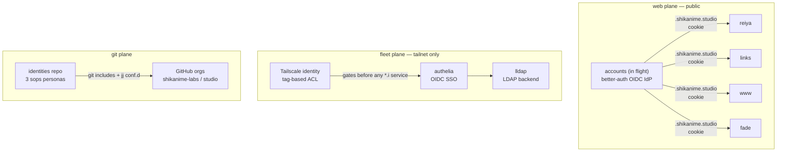

# Fleet identity

Two identity systems with different trust roots: the **web mesh**
(better-auth, public) and the **fleet plane** (Authelia + LLDAP +
sops, tailnet-only). They never share a root of trust by design.

## Git plane: the identities repo

Three personas, each a sops-encrypted record (name, email, signing
keys) that renders **only per-tool fragments** — git includes, jj
`conf.d/*.toml`, ghstack/glab config. The modules deliberately do not
enable git/jj themselves; they just inject identity into whatever
already manages the tool.

- `shikanime` — primary studio identity (GitHub/GitLab tokens,
  ghstack)
- `gouv` — government work, path-scoped via
  `git.condition gitpath:` to cloud-pi-native repos
- `automata` — the YoRHa operator persona; signs agent commits
  (`Co-authored-by: Automata <automata@shikanime.studio>`) and owns
  the A2A hub

SSH signing is fixed in-module: every commit from any persona is a
signed commit (verified badge on GitHub), enforced additionally by
protected-`main` rulesets.

## Fleet plane: Authelia + LLDAP

- **LLDAP** is the lightweight directory; admin via GraphQL on port
  17170 (port-forward `svc/lldap`). Users and groups live here.
- **Authelia** fronts it as the OIDC SSO for every `*.i.shikanime.studio`
  service that needs a login (Grafana, Forgejo, ...).
- Cluster workloads register as Authelia OIDC clients; the
  authelia+gitea-mirror pair shares one image digest — never
  bulk-replace it.

## Tailnet tags as capability tokens

The tailnet ACL grants by **tag**, not by node: `tag:k8s-node`,
`tag:server`, `tag:workstation`, `tag:machine`, per-app tags
(`tag:forgejo`, `tag:immich`, `tag:llama-cpp`, ...). Nodes receive
tags at provisioning (machines/manifests); the ACL file only maps
tag → allowed destinations. Workload identity federation applies it —
no API keys stored in CI.

## Secrets: sops everywhere

- At-rest: `secrets/<host>.enc.yaml` per host, age-encrypted,
  MAC-integrity-checked; editing = decrypt → modify → re-encrypt with
  the right recipients AND `--encrypted-regex` from metadata.
- At-render: `sops.templates` materialize env fragments into services
  (e.g. `hermes-agent-a2a-token-<peer>`) without writing plaintext to
  the store.
- Interactive: Vaultwarden (Bitwarden-compatible) for human secrets,
  synced separately from the fleet.
- Web: Cloudflare Worker secrets (`wrangler secret put`) per app —
  `BETTER_AUTH_SECRET`, `GOOGLE_CLIENT_SECRET` — never in the
  monorepo.

## Persona → commit mapping

| Author situation                  | Who signs                    |
| --------------------------------- | ---------------------------- |
| Human commit                      | persona's SSH key (identities) |
| Agent-assisted commit             | human persona + `Co-authored-by: Automata` trailer |
| Agent landing (`.land`)           | operator GitHub App token     |
| machines/manifests/skills         | additionally `Signed-off-by` (gitlint CC1) |
