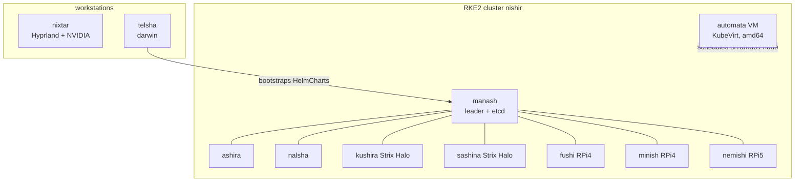
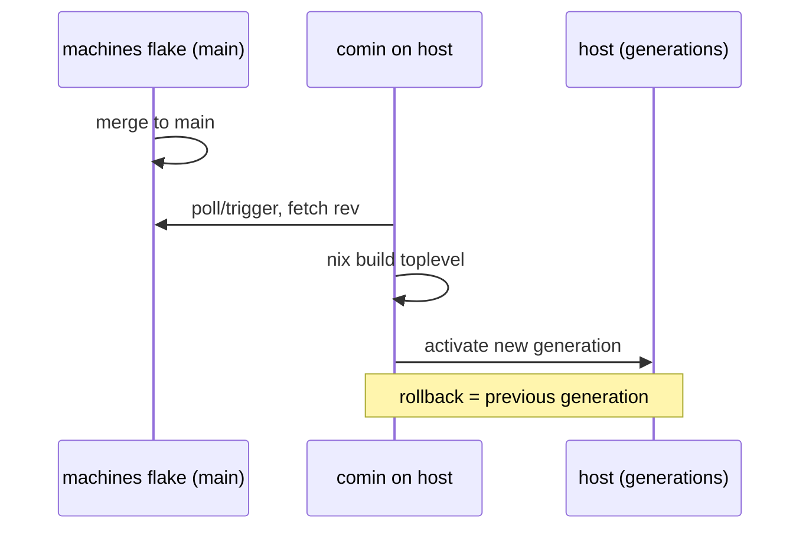

# Hardware fleet

The platform runs on eleven hosts managed by the
[`machines`](https://github.com/shikanime-labs/machines) flake.

| Host       | Hardware                                    | Arch       | Role                                    |
| ---------- | ------------------------------------------- | ---------- | --------------------------------------- |
| `manash`   | Beelink EQ14 mini PC                        | x86_64     | RKE2 control-plane anchor (`/mnt/flandre`) |
| `ashira`   | Beelink EQ14 mini PC                        | x86_64     | RKE2 worker (`/mnt/patchouli`, XFS)     |
| `nalsha`   | Beelink EQ14 mini PC                        | x86_64     | RKE2 worker (`/mnt/remilia`, XFS)       |
| `fushi`    | Raspberry Pi 4 Model B                      | aarch64    | RKE2 worker (SD-card image, arm builder) |
| `minish`   | Raspberry Pi 4 Model B                      | aarch64    | RKE2 worker (SD-card image, arm builder) |
| `nemishi`  | Raspberry Pi 5 (experimental NVMe edge)     | aarch64    | RKE2 worker + experimental edge         |
| `kushira`  | Minisforum MS-S1 Max, AMD Strix Halo (gfx1151) | x86_64  | RKE2 node + local LLM inference         |
| `sashina`  | Minisforum MS-S1 Max, AMD Strix Halo (gfx1151) | x86_64  | RKE2 node + local LLM inference         |
| `nixtar`   | Razer Blade 17 (2019), Intel + NVIDIA       | x86_64     | GUI workstation (Hyprland), knix leader |
| `automata` | NixOS qcow2 as OCI containerdisk            | x86_64     | KubeVirt VM — agent host (6 GiB / 2 vCPU) |
| `telsha`   | Apple silicon Mac                           | aarch64    | nix-darwin workstation, bootstrap host  |

## Fleet topology

The x86 server nodes and ARM nodes share the `nishir.nix` cluster profile:
Tailscale, SSH, Avahi, firewall, distributed build wiring, and the imports
every node shares (ai, distributed, forgejo, server). The Strix Halo nodes
(kushira/sashina) carry the local inference workload (see
[Inference](../services/inference)).

`automata` is the odd one out: a NixOS image built as a containerdisk and
run as a KubeVirt virtual machine in the cluster — it hosts the agent
automation plane (see [Agent automation](../automation/hermes)).

## Capability registry

Each host advertises build/cluster capabilities in
`modules/nixos/profiles/ai.nix`; distributed builds and agent routing both
key off them:

| Host            | Capabilities                                   |
| --------------- | ---------------------------------------------- |
| `manash`        | build, build-x86, k8s-leader                   |
| `nishir` (net)  | build-x86, k8s-leader                          |
| `ashira`        | build, build-x86, k8s-follower                 |
| `nalsha`        | build, build-x86, k8s-follower                 |
| `fushi`/`minish`| build, build-arm, k8s-node                     |
| `nemishi`       | build, build-arm, k8s-node                     |
| `kushira`       | build-x86, k8s-node                            |
| `sashina`       | build-x86, k8s-node                            |
| `nixtar`        | graphical, media, nvidia, k8s-leader           |
| `automata`      | command, workstation                           |
| `telsha`        | command, workstation, darwin                   |

## Distributed builds

`modules/nixos/profiles/distributed.nix` wires remote build machines so any
host can offload Nix builds to peers advertising `build` / `build-x86` /
`build-arm` capabilities. ARM workstations offload to the Pi builders and
vice versa; the Strix Halo nodes advertise `build-x86`.

## Deployment

Hosts pull their configuration via **comin** (git-pull deployment) —
`nixos-rebuild switch --flake .#<host>` remains available for manual
switches. Darwin host `telsha` uses `darwin-rebuild switch --flake .#telsha`.

