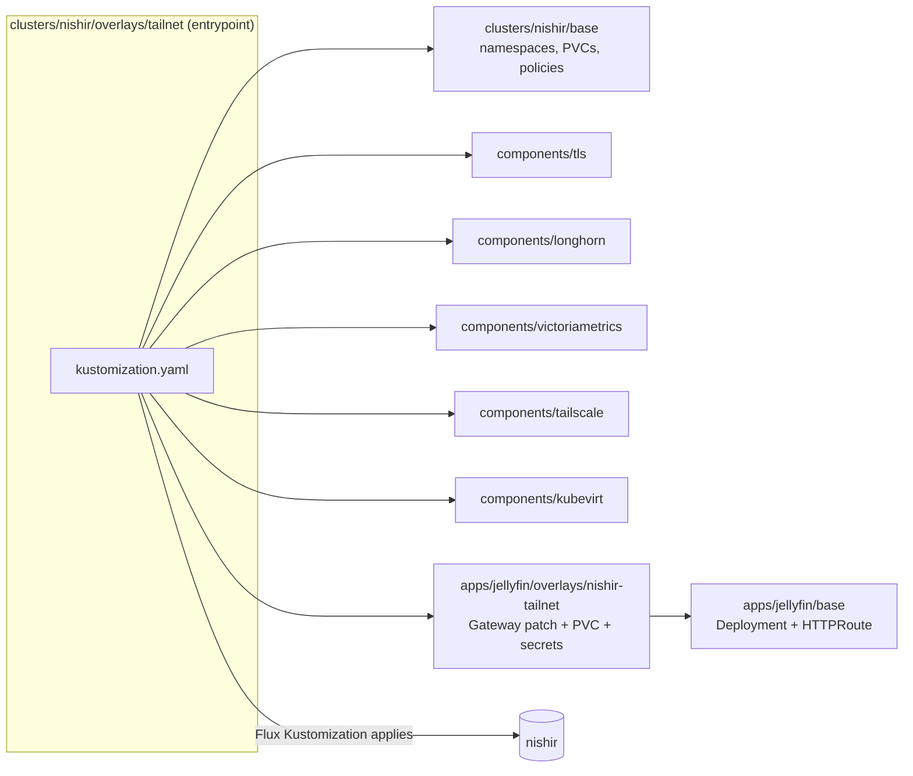
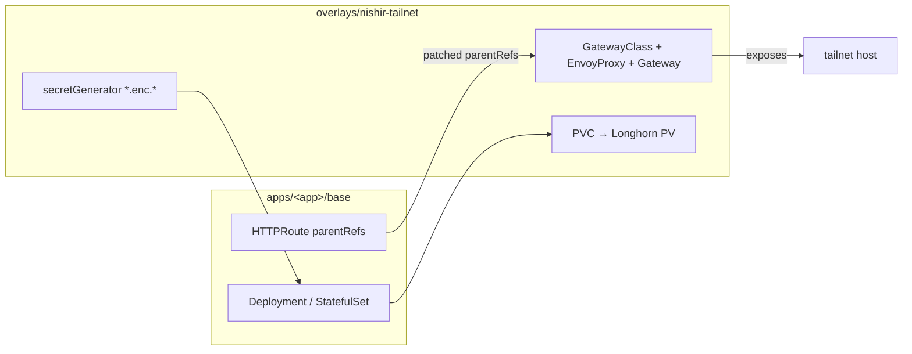
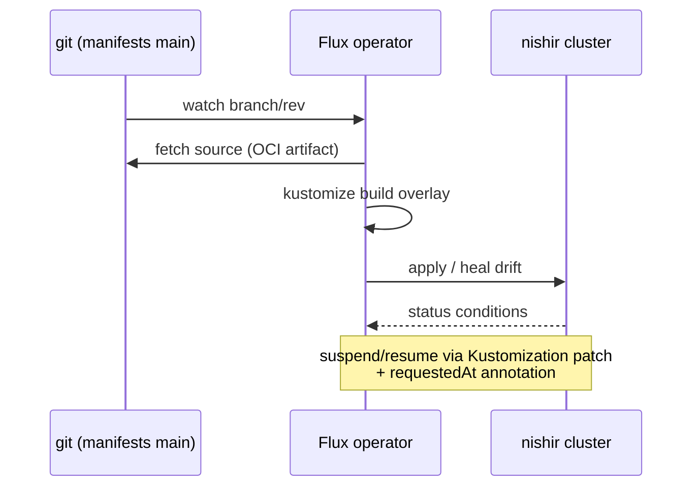

# Kubernetes

[`shikanime-labs/manifests`](https://github.com/shikanime-labs/manifests)
holds all cluster state as Kustomize trees, applied by Flux.

## Clusters

- **`nishir`** — the main cluster (RKE2 on the Nix fleet). Overlay
  `tailnet`; components: kubevirt, longhorn, tailscale, tls,
  victoriametrics — plus autoscaler, cert-manager, cluster-api,
  descheduler, envoy-gateway, envoy-ai-gateway, external-dns,
  flux-operator, gatekeeper, grafana-operator, local-path-provisioner,
  node-feature-discovery, trust-manager, victoria-logs.
- **`telsha`** — the Darwin-side cluster tree (overlay `tailnet`, component
  tailscale).

Controllers/operators are installed out-of-band from `bootstraps/`
(`HelmChart` resources), Flux reconciles everything else. KubeVirt is the
one exception to the HelmRelease pattern: version-pinned operator manifest

- `KubeVirt` CR under `infrastructure/kubevirt/`, because KubeVirt ships
no official Helm chart.

## Repo layout

- `apps/<app>/base/` — resources common everywhere
- `apps/<app>/components/` — optional Kustomize components (`tls/`, `ftp/`,
  `v4l/`)
- `apps/<app>/overlays/<cluster>/` — cluster patches
- `apps/<app>/overlays/<cluster>-tailnet/` — tailnet flavor
- `clusters/<cluster>/base/` — namespaces, shared PVCs, policies
- `clusters/<cluster>/components/` — cluster-wide components
- `clusters/<cluster>/overlays/<overlay>/` — the build entrypoints

## Kustomize composition schema

## App plug-in pattern

Most apps follow the same shape:

1. **Workload** — `Deployment`/`StatefulSet` in `apps/<app>/base/`
2. **Network** — per-app Envoy Gateway (`GatewayClass` + `EnvoyProxy` +
   `Gateway`) in the tailnet overlay; `HTTPRoute` in base whose
   `parentRefs` the overlay patches
3. **Storage** — PVC in the overlay bound to a Longhorn `PV`
4. **Secrets** — `*.enc.*` files fed through `secretGenerator`; decrypted
   outputs derive by stripping `.enc.`

## Platform add-ons

| Add-on             | Where                                          |
| ------------------ | ---------------------------------------------- |
| TLS / trust        | `clusters/<c>/components/tls/` (cert-manager, trust-manager `Bundle`) |
| Tailnet ingress    | `clusters/<c>/components/tailscale/` (Tailscale Operator) |
| Storage            | `clusters/<c>/components/longhorn/` (Longhorn settings, storage class, recurring jobs) |
| Observability      | `clusters/<c>/components/victoriametrics/` (VictoriaMetrics + Grafana) + `victoria-logs` |
| Vertical autoscale | per-app `vpa.yaml` (VPA controller)            |
| Virtualization     | `infrastructure/kubevirt/` (operator + CR)     |
| Policy             | `components/gatekeeper` (OPA)                  |
| Autoscaling        | `components/autoscaler`, `components/descheduler` |
| DNS                | `components/external-dns`                      |
| GitOps             | `components/flux-operator`                     |
| Inference gateway  | `components/envoy-ai-gateway`                  |
| Provisioning       | `components/cluster-api`                       |

## Reconciliation loop

## Notes

- VMs need `/dev/kvm` on the node (Intel VT-x / AMD-V); scheduling keys off
  the `nodes.kubevirt.io/resource/kvm` label published via
  node-feature-discovery.
- Longhorn PVCs cannot shrink while bound — size them minimally and grow;
  resizing requires delete pod+pvc+pv for volume-claim template flips.
- Config overlays each own their Flux `Kustomization`; skaffold render
  excludes cert material.
