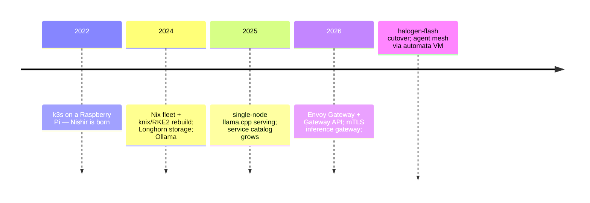

# Nishir: history and rationale

Nishir is the cluster everything runs on — but its current shape is the
result of four years of deliberate migrations, each solving a real
failure. This page explains both what it is and why it ended up this
way. (A "book and a doc": concepts first, reasons underneath.)

## The concept

Nishir is a **single-tenant, Git-driven Kubernetes cluster** assembled
from commodity hardware: three x86 mini PCs (control plane), three
Raspberry Pis (ARM workers), two Strix Halo inference nodes, one
KubeVirt VM for agent work. Nothing is publicly exposed; the tailnet is
the perimeter; Git is the only mutation path.

## The migrations, and what each fixed

### 2022 — a Pi and k3s

The repo dates to 2022-01-23; the Nishir tree was extracted into its
own structure 2022-11-01. It ran k3s on a Raspberry Pi with
hand-written manifests. Lesson that
shaped everything after: **hand-applied state drifts**. The repo existed
from day one, but early Kubernetes-on-Pi meant impermanent nodes —
SD-card wear, kernel config outside the cluster, PVCs restructured
repeatedly (Jan–Jul 2022 commits).

### 2024 — Nix fleet, RKE2, Longhorn

The rebuild that made the platform declarative end to end:

- **`machines` + `knix`**: every host became a NixOS machine defined in
  Git; RKE2 replaces k3s (knix adds the sysctls, CNI, and quorum
  wiring). Host drift stopped being possible — comin re-pulls and
  re-activates.
- **Longhorn** (Feb 2024 first added; local-disk migration May 2024):
  replaced node-local PV juggling ("Move Ollama PV" is a real commit
  subject from that era) with replicated, snapshot-capable storage.
  Constraint learned the hard way: Longhorn cannot shrink a bound PV —
  size PVCs minimally at creation.
- **Cluster family**: sibling clusters existed (Ishtar, Altashar,
  Kaltashar — added/removed 2024–2025); Nishir outlived them all, which
  is why its overlay is the richest.

### 2025 — the service catalog era

The `apps/` tree grew into the 32-app catalog (media, identity, forge,
Matrix). Ingress was still classic `Ingress` resources per app. Inference
was Ollama on one node — fine for one model, no routing, no auth.

### 2026 — the Gateway API year

Three consecutive migrations, each retiring a class of problem:

- **Ingress → Envoy Gateway / Gateway API** (Sep 2026, #2048): classic
  Ingress annotations had become a per-app dialect (TLS, auth, headers
  patched differently everywhere). Gateway API moved those to typed CRs
  — `ClientTrafficPolicy` for mTLS, `BackendTrafficPolicy` for session
  affinity, `HTTPRoute` filters for redirects. One gateway per app
  followed: blast radius of one bad deploy became one app, and the
  per-app gateway holding its own tailnet IP made ACL reasoning simple.
- **Inference gateway** (Sep 2026): Envoy **AI Gateway** in front of
  local models — one mTLS entry point, `x-ai-eg-model` routing, and
  remote-provider fallback tiers (nous/openrouter/z-ai) as
  `AIServiceBackend`s. Before it, every client held its own provider
  keys and its own retry logic.
- **halogen-flash cutover** (Sep 30, #2703): the llama.cpp RPC pair
  (two nodes bridged for one model, months of tuning: macvlan br1,
  chunked prefill, peer probes) lost to a single-node engine built for
  unified memory — 10–20× prefill. The route cut over Sep 30; the RPC
  pair's final removal landed Oct 6 (#2774). Full story: [AI infrastructure](../services/ai-infrastructure).

## Why it works the way it works (design invariants)

| Invariant                     | Reason it exists                                     |
| ----------------------------- | ---------------------------------------------------- |
| Git is the only write path    | every 2022-era outage was hand-edited state          |
| Nix hosts + RKE2 via knix     | host drift and kernel config rot killed the Pi era   |
| Flux, not CI-applied manifests| reconcile-on-poll converges after partitions         |
| Longhorn with minimal PVCs    | cannot shrink bound volumes; expansion is cheap      |
| One Gateway per exposed app   | typed policy CRs + single-app blast radius           |
| Tailnet as the only perimeter | no public LB to harden; ACL tags model capability    |
| mTLS + `sk-infer` keys on AI  | model access is fleet-identity-scoped                |
| KubeVirt for the agent hub    | agents get a disposable VM, not shell access to HW   |
| sops per-host secrets         | secret rotation is a commit, not a server visit      |

## The different paths to production

| Path          | Trigger          | Mechanism          | Latency |
| ------------- | ---------------- | ------------------ | ------- |
| Host config   | merge to `machines` | comin pull + switch | minutes |
| Cluster state | merge to `manifests` | Flux reconcile     | minutes |
| Web edge      | merge to `websites` | Workers Builds (docs: manual `wrangler deploy`) | seconds–minutes |
| Images        | `wharf`/`niximgs` build | ghcr.io + digest pins | on demand |

Each path is pull-based (self-healing after disconnect) except the edge.

## Reading the history yourself

The manifests repo's own log is the primary source —
`git log --format='%as %s' origin/main` in
`shikanime-labs/manifests` reads as the cluster's autobiography, from
"Initial commit" (2022-01-23) through every migration named above.
