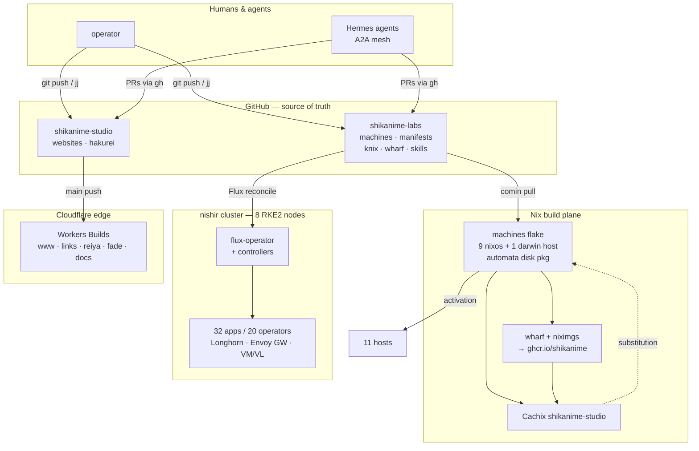
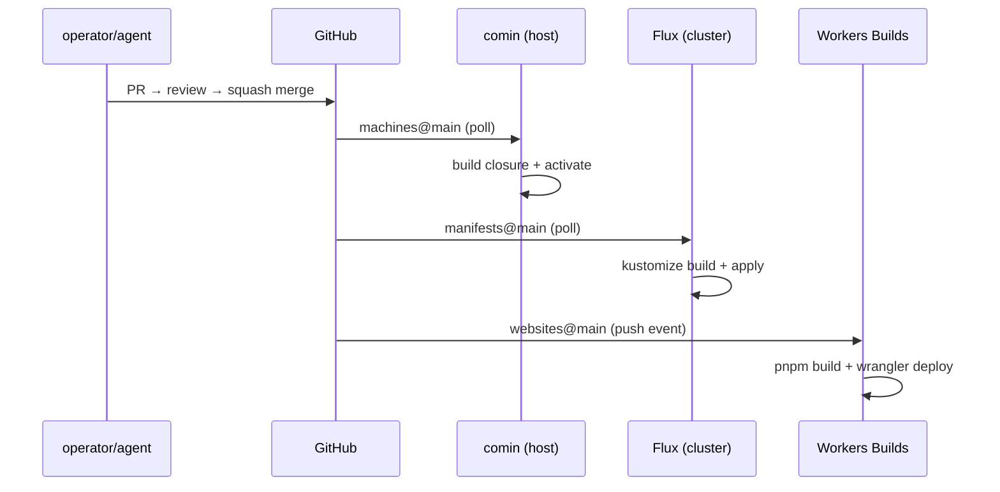

# System architecture

The platform is two planes joined by Git. The **control plane of
repositories** has GitHub as the source of truth. The **runtime
plane** is the Nix fleet, the RKE2 cluster, and the Cloudflare edge.
Nothing reaches production except through a commit.

## Layer model

| Layer         | Technology                          | Source of truth        |
| ------------- | ----------------------------------- | ---------------------- |
| Hardware      | 11 hosts, 3 arches                  | [Hardware fleet](./hardware) |
| Host config   | NixOS / nix-darwin + sops-nix       | [Nix fleet](./nix-fleet) |
| Kubernetes    | RKE2 via knix, Flux GitOps          | [Kubernetes](./kubernetes) |
| Ingress       | Envoy Gateway + Tailscale           | [Gateway & DNS](../networking/gateway-dns) |
| Edge          | Cloudflare Workers                  | [Web properties](../products/web-properties) |
| Automation    | Hermes + skills + actions           | [Automation](../automation/hermes) |

## The Git-to-production paths

Three distinct reconcile loops, all commit-driven:

1. **Hosts via comin:** commit to `machines` → comin on each host
   pulls its branch → new closure builds served from Cachix →
   activation. No SSH-driven mutation; drift self-heals on the next
   pull.
2. **Cluster via Flux:** commit to `manifests` → flux-operator detects →
   kustomize-controller builds the overlay → helm-controller /
   kustomize-controller apply → cluster state converges.
3. **Edge via Workers Builds:** merge to `websites` `main` → Cloudflare
   path-filtered build per app → wrangler deploy. Verified only by the
   log's `Uploaded`/`Deployed` lines.

## Agents as first-class operators

Every Nix host runs a `hermes-agent` service; the KubeVirt VM `automata`
is the A2A hub. Agents hold the same tools as humans — gh, jj, kubectl
read-only probes — and the same constraints: they push branches, open
PRs, and land only through the protected-`main` gates — the
[Landing protections](../automation/dev-workflow) ruleset blocks
self-approval even for agents. The capability split is encoded in the
tailnet ACL: machines talk to the cluster API plane, the hub relays
workstation traffic, and nothing crosses planes without a tag.

## Failure domains

- **Per-app gateways** — one Envoy data-plane deployment per exposed
  service; a bad deploy affects exactly one app's ingress.
- **Control-plane quorum** — manash/ashira/nalsha hold etcd; RKE2 server
  loss beyond one node freezes control-plane writes (workers keep
  serving).
- **Stateful storage** — Longhorn replicates within the cluster; PVCs
  are sized minimally because volumes cannot shrink once bound.
- **Secrets** — sops-encrypted at rest in Git; decrypted only at
  activation/reconcile time on the target host.
