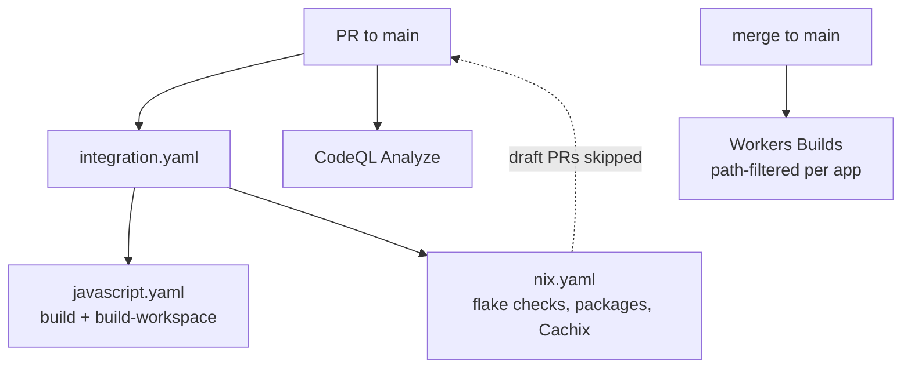

# Continuous integration

Every Shikanime Studio repository runs the same continuous-integration
grammar, driven by the reusable actions in `shikanime-labs/actions`.

## GitHub Actions

`shikanime-labs/actions`, pinned at v9, provides the reusable actions
every repo consumes: `nix/setup`, `nix/integration`, `checkout`,
`direnv`, `pnpm/integration`, plus `flux`, `skaffold`, `land`, `rebase`,
`backport`, `release`, `run`, `command`, `checks`, `cleanup`, `close`.
Draft PRs skip nix/skaffold jobs — mark a PR ready to arm them; a wedged
run is un-stuck by cancel + empty commit.

The `websites` repo runs `integration.yaml`, which calls
`javascript.yaml` for `build` plus recursive `build-workspace` via
`pnpm/integration`, and `nix.yaml` for flake checks plus packages with
Cachix `shikanime-studio`. It also runs `triage`, `commands`, `cleanup`,
and `release` workflows.

## Renovate

Dependency bots open green Renovate PRs; "land renovate PRs" means Gate 2
passed and they merge with `--squash --admin`. The `renovate/artifacts`
status is a non-required legacy check.

## Deploy verification

Cloudflare Workers Builds deploy `main` on push. A deploy is verified by
the build log's `Uploaded`/`Deployed` lines — never by the green check
alone. A wrong path filter exits green while building nothing.
