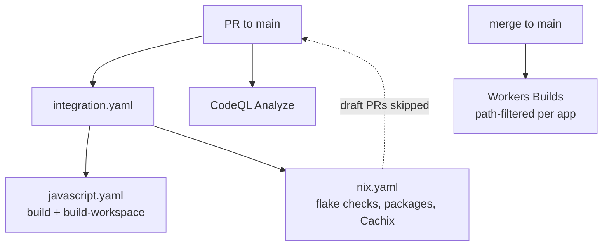

# CI & repo automation

## GitHub Actions

`shikanime-labs/actions` provides the reusable actions every repo consumes
(pinned at v9): `nix/setup`, `nix/integration`, `checkout`, `direnv`,
`pnpm/integration`, plus `flux`, `skaffold`, `land`, `rebase`, `backport`,
`release`, `run`, `command`, `checks`, `cleanup`, `close`. Draft PRs skip
nix/skaffold jobs — mark a PR ready to arm them; a wedged run is un-stuck
by cancel + empty commit.

The `websites` repo runs `integration.yaml` calling `javascript.yaml`
(`build` + recursive `build-workspace` via `pnpm/integration`) and
`nix.yaml` (flake checks + packages, Cachix `shikanime-studio`), plus
`triage`, `commands`, `cleanup`, and `release` workflows.

## Automata CLI

[`automata`](https://github.com/shikanime-labs/automata) (Go) keeps
repositories tidy:

- bumps kustomize image tags + recommended labels in `kustomization.yaml`
- bumps GitHub Actions versions in `.github/workflows`
- runs discovered `update.sh` scripts

It ships as a GitHub Action (`automata-action`) for hands-free landing.

## Renovate

Dependency bots open green Renovate PRs; "land renovate PRs" means Gate 2
passed and they merge with `--squash --admin`. The `renovate/artifacts`
status is a non-required legacy check.

## Deploy verification

Cloudflare Workers Builds deploy `main` on push. A deploy is verified by
the build log's `Uploaded`/`Deployed` lines — never by the green check
alone (a wrong path filter exits green while building nothing).
