# Workflow

Every Shikanime Studio repo runs the same loop: jj workspaces, plain-English
commits with trailers, PRs to protected `main`, squash landing. The loop
is codified in the `sks-*` skill family of `shikanime-labs/skills` and
is identical for humans and agents.

## Lifecycle

| # | Phase                      | Tool              | Gate                 |
| - | -------------------------- | ----------------- | -------------------- |
| 0 | Discussion (RFC) if open   | Discussion        | entry                |
| 1 | Issue: create → triage     | issue             | —                    |
| 2 | Refine to convergence      | issue refine      | ledger settled       |
| 3 | Branch + implement         | jj workspace      | workspace created    |
| 4 | Commit                     | commit envelope   | commit shape         |
| 5 | Adversarial review         | review lens       | review gate          |
| 6 | PR: open → triage          | `gh pr create`    | —                    |
| 7 | Land (`--squash`)          | `gh pr merge`     | branch protection    |
| 8 | Close issue (N of N)       | issue             | ledger discharged    |

```mermaid
flowchart LR
  I[issue ledger] --> WS["jj workspace add<br/>pinned to main@origin"]
  WS --> ED[edit in isolation]
  ED --> CM["jj describe<br/>subject + body + trailers"]
  CM --> BK["bookmark create + track"]
  BK --> PS["jj git push -b <branch>"]
  PS --> PR["gh pr create --head org:branch"]
  PR --> RV["review (ponytail lens)"]
  RV --> LG["gh pr merge --squash"]
  LG --> CL["verify + close issue"]
```



## jj is the working surface

All org repos are jj-managed. Two rules prevent most damage.

**Never work in the cloned checkout.** Every unit opens a fresh
workspace pinned to the remote tip:
`jj workspace add ../<repo>.<unit> -r 'main@origin'`. Concurrent WIP
in the checkout never folds into your change.

**Pushed bookmarks are immutable.** To rebuild a branch: `jj new` off
`main@origin`, `jj restore --from <old>` only the intended files,
re-point the bookmark with `--allow-backwards`, push. Always re-diff
against `main` — `restore` carries over whatever the old commit held.

jj does not auto-track bookmarks: `jj bookmark track <branch>
--remote=origin` before `jj git push`, or the push is rejected. A success
line proves nothing — verify the bookmark moved and the PR head OID
equals local `@`.

## Commit envelope

Plain capitalized title with no conventional-commit prefix, body with
the labels `Design:`, `Related:`, `Issue:` per the repo's `AGENTS.md`,
plus trailers. The `Co-authored-by: Automata` trailer appears only on
commits that used the automata agent or the inference infrastructure.

```text
Co-authored-by: Automata <automata@shikanime.studio>
Signed-off-by: <contributor> <email>
```

`manifests` and `skills` enforce `Signed-off-by` via gitlint rule CC1 —
a commit without it is rejected at push.

## PRs and landing

PRs open with `--head <org>:<branch>`, where `<org>` is the repo owner
and not the login, and body sections `# Why` / `## What` /
`## References` restating the commit. Bodies are written to a file and
passed via `--body-file` — inline `--body` gets mangled by shell
expansion.

`main` is protected in both orgs: 1 approval, linear history, signed
commits, squash-only. A verbal "lgtm" is the approval signal. After
it, `gh pr merge --squash --admin` lands the PR. Self-approval is
blocked by the org "Landing protections" ruleset.

Check for duplicates first: if an open PR already delivers the change,
stack on its branch instead of opening another. Stacks land in
dependency order, base first.

Inside a jj workspace gh has no git remote — pass `-R <org>/<repo>`.

## Branch classes

| Signal                        | Implication                          |
| ----------------------------- | ------------------------------------ |
| `main` protected              | PR mandatory, squash landing         |
| `.jj/` present                | jj bookmark tracking before push     |
| gitlint / DCO hooks           | `Signed-off-by` mandatory            |
| `AGENTS.md` with `Related:`   | follow its conventions               |
| NixOS/infra repo              | `nix eval` / `nix build` before land |

## Formatting

`nix fmt` runs treefmt over the whole tree per run — scope it to your
app with `nix fmt apps/<app>` and restore anything outside your change
before committing. Markdown wraps at 80 columns; never skip the formatter, and
never run it over GitHub issue/PR bodies. Those bodies are free text
and are exempt.

## Verification before "done"

"Pushed / landed / merged" are claims until checked against real output:
`gh pr view <n> --json state,headRefOid` after create and merge, and
re-measure any file/line count with `jj diff --stat` — GitHub's web diff
pads context and overstates size.
