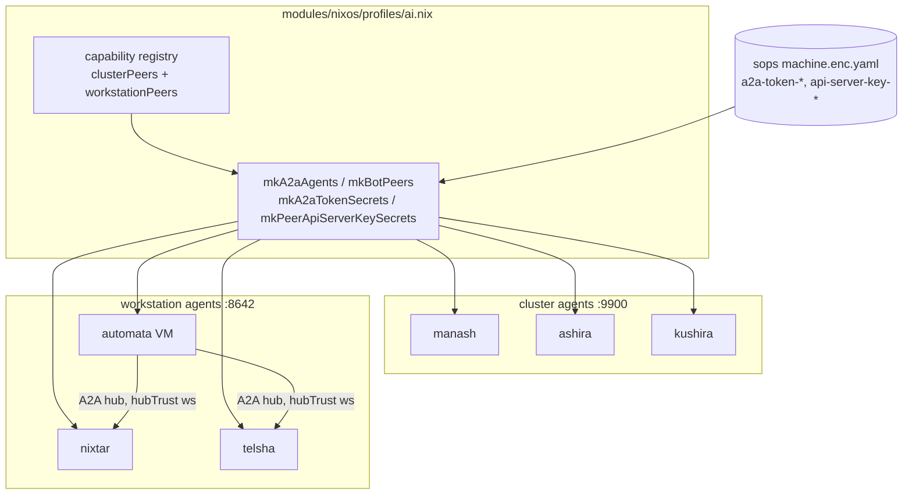
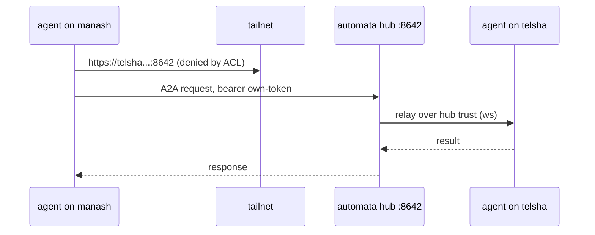

# Automata

Agent automation across the platform runs on **Hermes Agent** instances,
declared in the machines flake at `modules/nixos/profiles/ai.nix` and
run fleet-wide — every Nix host runs a hermes-agent service, and the
KubeVirt VM `automata` acts as the central hub.

## Mesh schema

The peer list is Nix-generated from the capability registry: cluster
peers on the `:9900` API, workstation/bot peers on `:8642` A2A, hub
peers, each with per-peer sops secrets materialized through
`sops.templates`.

## The automata hub

`automata` is a NixOS qcow2 wrapped as an OCI containerdisk. The
machines flake builds it as `packages.x86_64-linux.automata`, and it
runs as a KubeVirt VM in the nishir cluster: q35 machine, EFI without
secure boot, 6 GiB RAM / 2 vCPU requested, amd64 node selector, root
containerDisk + a PVC workspaces disk + cloud-init over a Secret.

It is **the A2A hub**: peer agents register against it, and `hubTrust`
means the hub accepts `ws` connections.

## A2A mesh

Peers address each other over the tailnet:

- Peer endpoints: `https://<peer>.taila659a.ts.net:8642`
- Hub expose: `https://a2a.automata.i.shikanime.studio`
- Ports `9900`/`8642` between tailnet peers are plain HTTP; TLS terminates
  at the `a2a.<app>.i.shikanime.studio` vanity names.
- Auth tokens per peer: sops secrets `hermes-agent-a2a-token-<peer>`,
  materialized into the agent env via `sops.templates`.
- Per-peer API server keys: `hermes-agent-api-server-key-<peer>` injected
  as `HERMES_PEER_<NAME>_KEY` env lines.

Machine-to-workstation links are denied by tailnet ACL — the hub relays.

## Nix-packaged Hermes plugins

| Plugin                    | Role                                    |
| ------------------------- | --------------------------------------- |
| `hermes-plugin-honcho`    | agent memory backend (Honcho)           |
| `hermes-plugin-lcm`       | LCM integration                         |
| `hermes-plugin-memory-wiki` | llm-wiki knowledge base               |
| `hermes-plugin-ponytail`  | lazy-code review lens                   |
| `honcho-ai`               | Honcho AI client library                |

## Skills

The `shikanime-labs/skills` repo is a curated catalog of self-improved
agent skills. The `sks-*` family covers dev loop, PR landing, issue
triage, nix authoring, sops authoring, and more. Skills are mirrored to
`~/.hermes/skills` as a detached git clone; resync is fetch + ff-only
main, stashing local lessons.

## Computer use

`ai.nix` installs the `cua-driver` binary for AT-SPI/D-Bus fleet-wide,
so hermes' `computer-use` extra can drive desktop automation on any
host.
