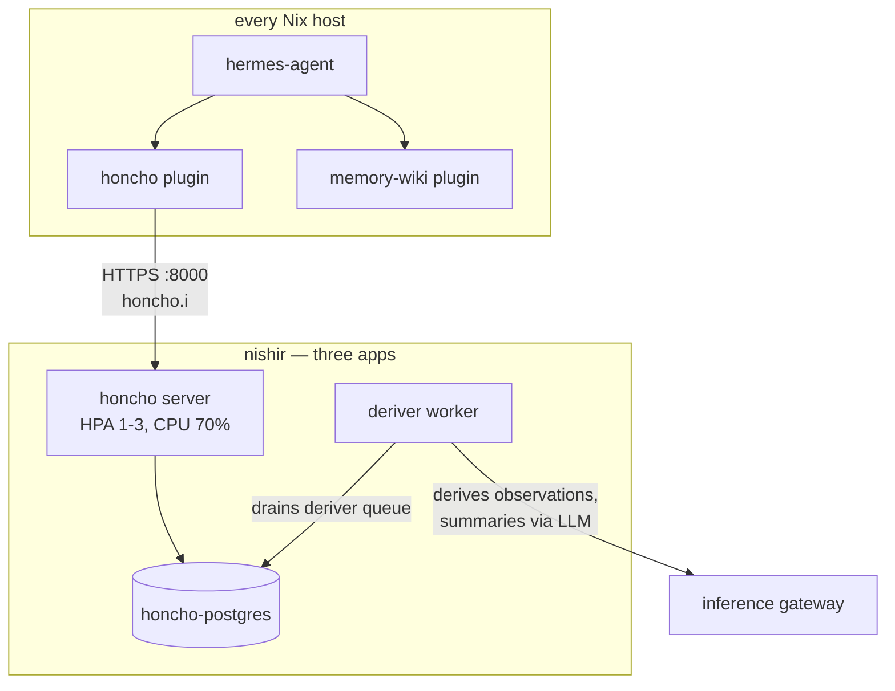

# Memory

Agents that operate a fleet need continuity between sessions. The
memory system gives every Hermes agent durable, queryable recall, the
same way the skills catalog gives it procedure. It is a core part of
the automation plane, not an accessory.

## Architecture

Honcho is the conversational memory server
(`ghcr.io/plastic-labs/honcho`) at `honcho.i.shikanime.studio`, backed
by its own Postgres and a deriver worker. Every hermes-agent on the
fleet speaks to it through the `honcho` plugin; the agent config sets
`memory.provider = "honcho"` fleet-wide in the `ai.nix` profile.

## The three moving parts

The honcho server stores conversation turns and answers queries on
port 8000, scaled by an HPA between one and three replicas. An alembic
init container migrates the Postgres schema before each start, so the
database shape always matches the running image.

The deriver worker runs upstream's `python -m src.deriver` from the
same digest-pinned image. It drains a queue inside Postgres and
derives per-peer observations, summaries, and working
representations, using the inference gateway as its LLM. It deploys as
a separate app with its own labels so the honcho Service can never
select it — a shared selector once caused an endpoint black hole
(#2200).

`honcho-postgres` is the state: conversations, derived metadata, and
the queue, on a Longhorn PVC.

## How agents use it

The hermes `honcho` plugin reads and writes memory transparently
during conversations. The `memory-wiki` plugin layers a
knowledge-base view on top — distilled, wiki-shaped recall for facts
that outlive a single peer's session. Sessions auto-prune, so recall
stays relevant rather than accumulating noise. The netpol admits only
hermes-agent pods and vmagent to the server, keeping memory scoped to
the agent fleet.

## Why it matters

Skills encode how to act; memory encodes what happened. Together they
make an agent that lands a PR today remember the runbook decision from
last week — the difference between an automation fleet and a set of
ephemeral assistants.
