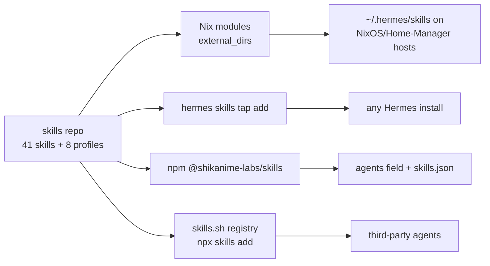

# Skills catalog

[`shikanime-labs/skills`](https://github.com/shikanime-labs/skills) is
the org's procedural memory: a curated catalog of self-improved agent
skills for Hermes (and compatible agents — Claude Code, Codex, Cursor)
encoding one **issue-first lifecycle**: discussion → issue → comments →
PR.

## Shape

- **41 skills** under `skills/` — the `sks-*` family
  (`sks-dev`, `sks-pr`, `sks-issue`, `sks-land`, `sks-nix-authoring`,
  `sks-sops-secrets-authoring`, ...) plus `cpn-release-patch` and
  `nixpkgs-pr-review`
- **8 profiles** under `profiles/`: coder, commander, debugger,
  designer, neuromancer, releaser, researcher, reviewer
- Bodies are **org-neutral**; per-org facts load on demand from
  `references/shikanime.md` / `references/cloud-pi-native.md` — the
  same skill works in any org
- Doctrine carried by every skill: issue-first, acceptance criteria as
  command-decidable tasklists ("gate ledgers"), done-is-proven

## Distribution

The same catalog reaches every runtime four ways:

On fleet hosts, `machines`/`skills` Nix modules set
`services.hermes-agent.settings.skills.external_dirs`, mounting the
catalog into `~/.hermes/skills` — which is how the agents documented in
[Hermes agent fleet](./hermes) know the dev loop at all.

## CI

The repo runs the org workflow grammar (`cleanup`, `commands`,
`integration`, `nix`, `release`, `triage`); `nix.yaml` runs Checks +
Packages matrix jobs pushing to the `shikanime-studio` Cachix cache.
Commits are gitlint-enforced (`Signed-off-by`, CC1). Local mirror
discipline: `~/.hermes/skills` is a detached clone — resync is fetch +
ff-only `main`, stashing local lessons.
