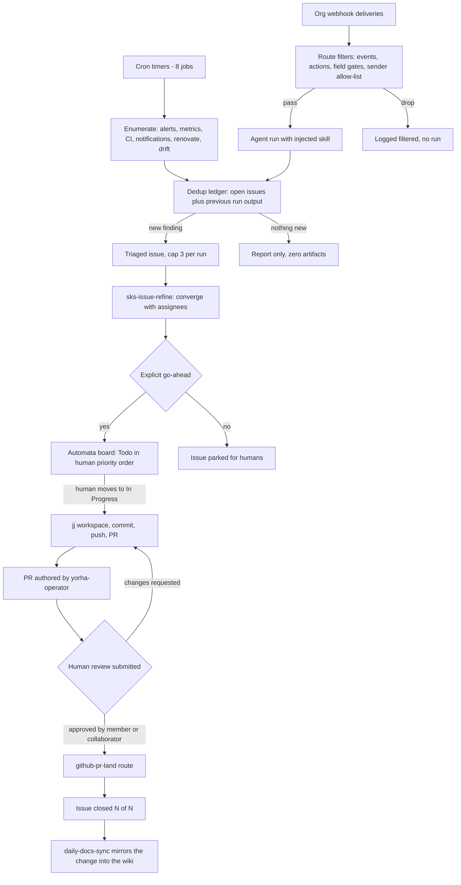

# Webhooks and cronjobs

The automata agent reacts to GitHub events and runs the fleet's
recurring audits. Both surfaces are declared in
`shikanime-labs/machines` under
`modules/nixos/profiles/automata.nix` — the host filesystem is
ephemeral, so nothing is registered at runtime. Cron jobs set
`deliver = "local"` and webhook routes set `deliver = "log"`: run
output stays in the guest logs (`~/.hermes/logs/gateway.log` and the
cron run records) and nothing posts to Discord, Matrix, or PR comments
automatically. Every GitHub side effect is an explicit `gh` call from
inside the run.

## Flow



Both intakes converge on the same ledger discipline: dedup against
open issues and the previous run output before acting; a cron run is
killed at about 3 minutes; at most one small PR per run and at most 3
filed issues per run.

## Webhook routes

The webhook platform listens on port `8644`, guarded by the
`hermes-agent-webhook-secret` sops secret, with a rate limit of 120
requests per minute. One route per URL path; org-level hooks on
`shikanime-labs` and `shikanime-studio` deliver to
`https://automata-webhook.taila659a.ts.net/webhooks/<route>`. A failed
filter gate logs `[webhook] filtered` and no run starts. Each route
injects exactly one skill and runs with the `terminal`, `file`, `web`,
and `skills` toolsets.

| Route | Events | Gates | Skill |
|---|---|---|---|
| `github-issue` | `issues` | action `opened`, `reopened`, `edited`; payload is not a pull request; sender is `shikanime` or `yorha-operator` | `sks-triage` |
| `github-refine` | `issues` | action `assigned`; assignee is `yorha-operator`; sender allow-list | `sks-issue-refine` |
| `github-mention` | `issue_comment`, `pull_request_review_comment` | action `created`, `edited`; body contains `@yorha-operator`; sender is `shikanime` | `sks-triage` |
| `github-pr` | `pull_request` | action `opened`, `reopened`, `synchronize`, `review_requested`, `edited`; not draft; `mergeable` not false; `yorha-operator` among requested reviewers; sender allow-list | `sks-pr-review` |
| `github-pr-land` | `pull_request_review` | review `submitted`; state `approved`, `commented`, or `changes_requested`; PR authored by `yorha-operator`; sender is not `yorha-operator`; reviewer association `COLLABORATOR`, `MEMBER`, or `OWNER` | `sks-land` |
| `github-project` | `projects_v2_item` | action `edited` only (created carries no `changes` field); the Automata board's `project_node_id`; `content_type` Issue; the Status field's `field_node_id` changed in `changes.field_value`; sender is `shikanime` | `sks-dev` |

The `github-project` route is the prioritization stage between refine and
implementation: refined issues stay `Todo` on the Automata board in human
priority order, and moving a card to `In Progress` is what dispatches the
dev loop for it. The payload carries node ids only — no issue number — so
the run resolves number and repository from `content_node_id` through the
GraphQL node API, then clones and follows the dev loop: small
fastlane-eligible work lands, bigger work stays a reviewed PR. The run
never writes to the board: the receiver token holds no project scope, and
the card's flip to `Done` is a native project workflow. Registration: one
`projects_v2_item` org hook per org pointing at
`/webhooks/github-project`.

The `cloud-pi-native` org carries no hooks — this account holds only
member there — so its coverage is cron polling.

## Scheduled jobs

Jobs live in VCS: `hermesHomeFiles."cron/jobs.json"` in the automata
profile, all delivering locally to the Hermes log. Daily jobs sit on
15-minute staggers from 00:45 through 02:30 guest time, inside the
inference gateway's measured zero-deferral night window.

| Job | Schedule | Skills | Scope and caps |
|---|---|---|---|
| `daily-docs-sync` | `45 0 * * *` | `sks-wiki`, `sks-issue`, `sks-commit`, `sks-pr`, `sks-fastlane` | Recent org changes mirrored into the per-repo GitHub wikis, stalest first, at most 2 wiki syncs per run; then docs.shikanime.studio claims verified against manifests and live cluster state, drift filed in this repo. |
| `weekly-fleet-efficiency-audit` | `0 1 * * 1` | `sks-issue` | Efficiency proposals from A2A peers; top 3 filed as issues in `shikanime-labs/manifests`; proposals only, no PRs. |
| `daily-fleet-health-audit` | `15 1 * * *` | `sks-audit`, `sks-issue`, `sks-commit`, `sks-pr`, `sks-fastlane` | Every `sks-audit` surface over the whole fleet and all three orgs: security alerts, perimeter redteam, CI failures, firing alerts, Flux health, Kubernetes warning events; max 3 issues; never closes or edits what it audits. |
| `daily-github-triage` | `30 1 * * *` | `sks-triage`, `sks-issue` | Triage across shikanime-labs, shikanime-studio, and cloud-pi-native. |
| `daily-github-cleanup` | `45 1 * * *` | `sks-gc` | Cleanup sweep across the three orgs. |
| `15m-github-notification-sweep` | `2,17,32,47 * * * *` | `sks-github-notif-sweep`, `sks-triage` | Unread notifications for shikanime-labs and shikanime-studio; the slots never coincide with the daily block. |
| `daily-renovate-landing` | `30 2 * * *` | `sks-maintenance`, `sks-issue`, `sks-land` | Landing pass over open renovate PRs across the three orgs. |
| `monthly-sdlc-efficiency-audit` | `0 3 1 * *` | `sks-audit`, `sks-issue` | Monthly SDLC efficiency audit over the `sks-audit` SDLC surface: census, untriaged scan, review and merge latency with bot rows split out, merged-PR residue, landing-gate stalls, stale branches; max 3 issues with measured baselines. |

The issue-filing jobs share one contract:

- Deduplicate against open issues and the previous run output; tracked
  findings are listed, never re-filed. A clean sweep reports nothing
  new and produces zero artifacts.
- Findings land as triaged issues in `shikanime-labs/manifests`,
  `shikanime-studio/websites`, or the affected repo, assigned
  `yorha-operator` when eligible, at most 3 per run.
- Small fixes may take the fastlane path; the eligibility gate is
  owned by the `sks-fastlane` skill and the cap is one small PR per
  run. Pending or red checks leave the PR open for the next run.
- Nothing closes, dismisses, silences, or edits automatically;
  resolution is human-verified.

## Workstation jobs

The operator's workstation runs a second set outside VCS, declared in
`~/.hermes/cron/jobs.json` of the local Hermes profile. Schedules sit
in the 04:00–05:30 CET window on 15-minute boundaries — the same
zero-deferral hours the fleet jobs target — with the 15-minute sweep
on the `:02/:17/:32/:47` slots.

| Job | Schedule | Scope |
|---|---|---|
| `daily-cpn-docs-sync` | `0 4 * * *` | All commits across cloud-pi-native reflected into the org's two documentation repos; cursor-based continuity, one sync per run. |
| `15m-github-notification-sweep` | `2,17,32,47 * * * *` | Unread notifications for shikanime-labs and shikanime-studio, answered as `yorha-operator`; repos without a webhook reach the agent through this sweep. |
| `daily-cpn-github-sweep` | `30 4 * * *` | New and open cloud-pi-native items org-wide; read-only report. |
| `daily-cpin-github-triage` | `45 4 * * *` | Triage of open cloud-pi-native PRs and issues, all authors equally; read-only classification. |
| `daily-cpin-github-actions-failure-triage` | `0 5 * * *` | Failed Actions runs org-wide in the last 24 hours; read-only diagnosis and classification. |
| `weekly-veille-technologique` | `15 4 * * 1` | Technology watch and skills-catalog consolidation for the profile; delivers to Discord. |
| `weekly-cpin-security-audit` | `0 5 * * 2` | Code-scanning, secret-scanning, and Dependabot alerts plus security-bot comments on the org's active repos. Read-only: never dismisses alerts, never opens fix PRs. |
| `weekly-cpin-security-redteam` | `15 5 * * 3` | Findings tracker over the cloud-pi-native red-team ledger issue in `documentation-interne-socle`; statuses each finding and reports the unremediated count and oldest age. Read-only; reports in French. |
| `monthly-org-process-improvement` | `30 5 1 * *` | Proposals-only process sweep across shikanime-labs and shikanime-studio; at most 3 issues per run against the previous run's ledger; hard 3-minute bound. |

The two weekly cloud-pi-native security jobs carry one deliberate
exception in their prompts: console's unsalted SHA-256 token hash is
required design, not a finding — salting would invalidate every shared
token — and bot comments anchoring to old commits must be re-checked
against the file at HEAD before reporting.

## Deployment

Routes and jobs reach the fleet only through a containerdisk rebuild of
the automata image; editing the live agent changes nothing. The
`hermes-agent-events-env` sops template injects the webhook port and
secret into the service environment, and a rebuild restarts
`hermes-agent.service` with the new declarations. Workstation jobs take
effect on save — the local scheduler picks up `jobs.json` without a
restart.

A merged machines PR is not live until the containerdisk chain
completes: image publish on the main push, a manifests bump of the
automata pin, then the VM restart. Compare `systemctl show
hermes-agent -p ExecMainStartTimestamp` with the rendered `config.yaml`
mtime — an older PID means the process is serving pre-merge
declarations — then signed-ping every route.

## Operations

Audit the hook inventory — a second hook with the same URL and events
doubles every delivery:

```sh
gh api orgs/shikanime-labs/hooks --jq '.[] | {id, url: .config.url, events}'
gh api orgs/shikanime-studio/hooks --jq '.[] | {id, url: .config.url, events}'
```

Run evidence lives on the receiver's file logs, not journald:

```sh
grep "route=" ~/.hermes/logs/gateway.log
ls ~/.hermes/cron/output/
```
