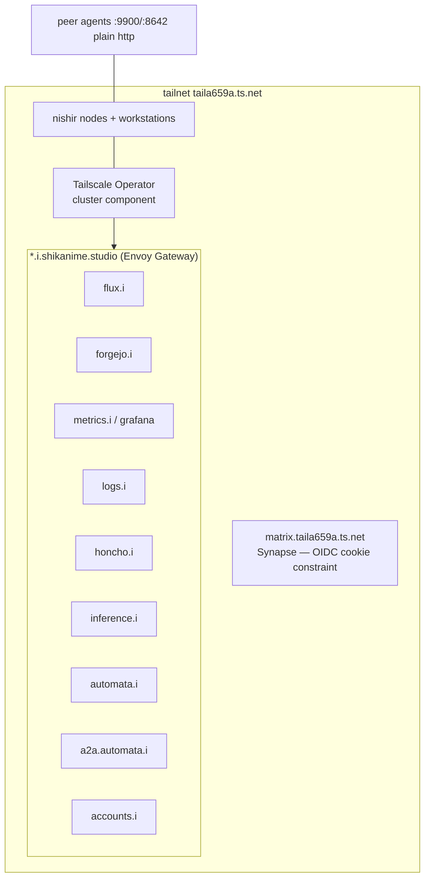

# Tailnet

All infrastructure connectivity rides a Tailscale tailnet (`*.taila659a.ts.net`):

- Every Nix fleet host joins the tailnet via the `nishir` profile.
- The Kubernetes API and cluster services are reached through the
  **Tailscale Operator** (`clusters/<c>/components/tailscale/`), which
  exposes services as tailnet hosts.
- In-cluster services get vanity names under `*.i.shikanime.studio`
  (Envoy Gateway): `flux.i`, `forgejo.i`, `grafana`/`metrics.i`, `logs.i`,
  `honcho.i`, `inference.i`, `automata.i`, `a2a.automata.i`,
  `accounts.i`.
- Matrix (Synapse) clients use `matrix.taila659a.ts.net` — the vanity
  hostname breaks the OIDC cookie flow, so the tailnet name is canonical
  for clients.
- Tailnet ACLs are GitOps-managed in `shikanime-labs/tailnet`; the
  `tailscale-gateway` repos wire gateway exposure.

## Network schema

Plain HTTP (9900, 8642) is used between tailnet peers; TLS terminates at
`a2a.<app>.i.shikanime.studio` for the agent plane.

## ACL model

`shikanime-labs/tailnet` holds the ACL as code. Two rules worth knowing:

- machine → workstation links are **denied** (the automata hub relays
  agent traffic instead)
- workstation ↔ workstation and machine ↔ machine are allowed for the
  peer ports

DNS: tailnet split-DNS serves `*.i.shikanime.studio` inside the cluster;
when tailnet or i-domain DNS fails inside pods, check the
`tailscale` component first.
