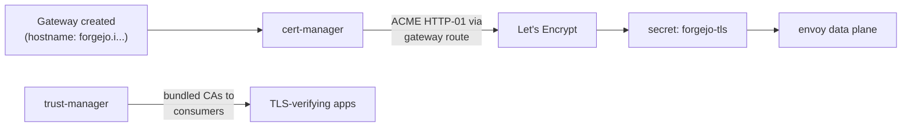

# DNS & TLS

Two DNS systems and two TLS issuance paths, one per plane, plus the
known edges where they interact badly.

## DNS

| Zone                        | Managed by        | Records                          |
| --------------------------- | ----------------- | -------------------------------- |
| `shikanime.studio` (public) | Cloudflare        | Worker custom domains, proxied CNAMEs (legacy Pages era in `infra/`) |
| `taila659a.ts.net`          | Tailscale MagicDNS | host names, operator-exposed services |
| `i.shikanime.studio`        | external-dns (in-cluster) | per-app vanity names → Gateway 100.x |

- **external-dns** watches Gateway/HTTPRoute resources and maintains
  the `*.i` records — app exposure is fully declarative.
- **blocky** runs as the fleet's DNS sinkhole (ad/malware blocking)
  with its own Grafana dashboard.
- The vanity names resolve **inside the tailnet only** — they point at
  100.x addresses.

## TLS

| Termination point    | Issuer                    | Cert manager        |
| -------------------- | ------------------------- | ------------------- |
| Cloudflare edge      | Cloudflare (zone cert)    | — |
| Tailnet service GWs  | Let's Encrypt via cert-manager | `cert-manager-system` + `trust-manager` (CA bundle distribution) |
| Inference plane      | mTLS (client certs)       | Envoy AI Gateway `BackendSecurityPolicy` |
| Matrix Synapse       | tailscale cert            | — (tailnet name only) |

## Known edges (verified incidents)

- **Matrix/OIDC cookie break:** Synapse clients must use
  `matrix.taila659a.ts.net`. The vanity hostname passes through the
  gateway and breaks the OIDC cookie round-trip — the tailnet name is
  canonical for clients.
- **Split DNS:** pods resolving tailnet names depend on the cluster's
  DNS forwarding (coredns via knix); a mismatch shows up as pods
  reaching services by IP but not by MagicDNS name.
- **Custom domains on Workers** take over the hostname at the zone
  level: an app moved from Pages to Workers must re-add its
  `custom_domain` route or the hostname 404s (cfproxy decommission
  taught this).

## Certificate lifecycle

Renewal is automatic; the failure mode to watch is a gateway whose
hostname record was deleted out-of-band — cert-manager retries forever
while envoy serves the previous cert.
