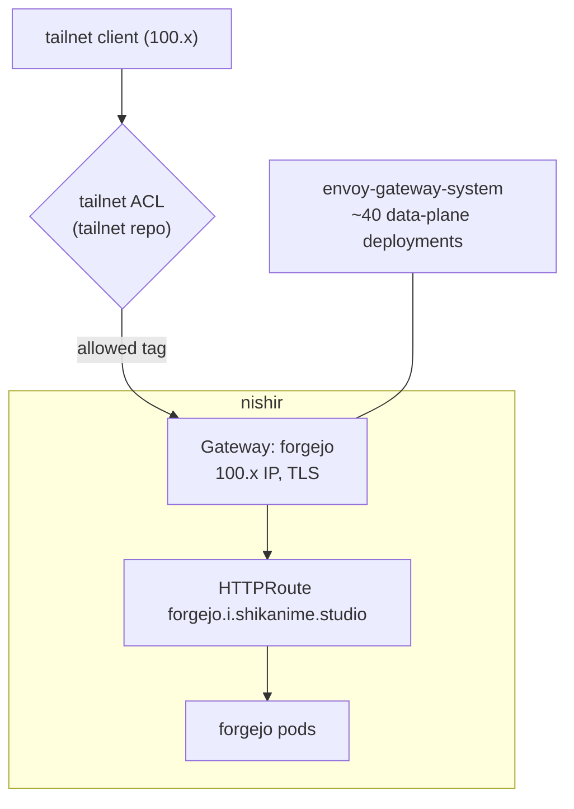

# Gateway & DNS

Shikanime Studio's ingress model is **tailnet-native**: there is no public
load balancer. Every exposed service gets its own Gateway API `Gateway`
holding a Tailscale `100.x` IP, reachable only from the tailnet, gated
by the ACL repo.

## The pattern

Live state: **40 Gateways**, 39 of them Programmed, and 104 HTTPRoutes.
The `shikanime` namespace alone hosts 34 per-app gateways — authelia,
forgejo, immich, jellyfin, the *arr stack, synapse, llama-cpp,
inference, hermes-agent, honcho, and more — plus gateways for
Grafana/VictoriaLogs, Longhorn, and Flux.

- **Envoy Gateway** in `envoy-gateway-system` runs the data plane; each
  exposed app gets a dedicated per-app Gateway + envoy deployment —
  blast radius of one app per gateway
- **Vanity names** under `*.i.shikanime.studio` route to these
  gateways. The mTLS inference plane is the exception — see
  [Inference platform](../services/ai-infrastructure).
- **external-dns** manages DNS records; **cert-manager +
  trust-manager** issue TLS for the gateway hostnames
- The **tailscale-operator** component wires cluster services into the
  tailnet; the standalone `tailscale-gateway` controller can also
  expose Gateway API services onto the tailnet via Tailscale Serve

## ACL as the perimeter

The ACL file is `policy.hujson` in `shikanime-labs/tailnet`. Push to
main applies it via workload identity federation — no stored API keys.
42 tags are in use: `tag:k8s-node`, `tag:server`, `tag:workstation`,
and per-app tags like `tag:forgejo`, `tag:immich`. Nodes are tagged
where they are provisioned, in machines/manifests, never by adding
tagOwners.

Known edges: machine → workstation links are denied, and the automata
hub relays agent traffic. Matrix clients must use the tailnet name
`matrix.taila659a.ts.net` — the vanity hostname breaks the OIDC cookie
flow.
