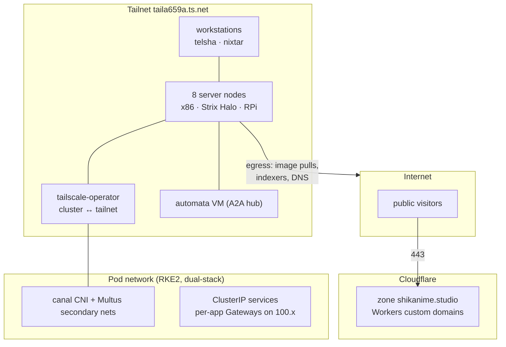

# Topology

Three network domains, deliberately isolated: the public Cloudflare
edge, the tailnet, and the pod network. Cross-domain traffic exists
only where a diagram in this book shows it.

## Domains

| Domain      | Address space             | Reachable from           |
| ----------- | ------------------------- | ------------------------ |
| Edge        | `*.shikanime.studio` (public DNS) | Internet           |
| Tailnet     | `100.64.0.0/10` + MagicDNS `*.taila659a.ts.net` | Tailnet members |
| Cluster     | dual-stack pod/service CIDRs (knix defaults) | tailnet via operator, in-cluster |

## The tailnet as the only admin plane

There is no public path to any cluster service. The Kubernetes API is
reached at `nishir-k8s-operator.taila659a.ts.net` — a tailscale-operator
exposed endpoint — and every per-app Gateway holds a tailnet `100.x`
address — see [Gateways](./gateway-dns). Administration from
outside requires tailnet membership first; membership + tag then
determines reachability via the [ACL](./tailnet).

## Cluster networking

- **CNI:** canal — Calico policy + flannel — with kernel tuning from
  knix: bridge netfilter, overlayfs, BBR, enlarged conntrack and
  neighbor tables, dual-stack forwarding.
- **Multus** attaches secondary networks where a pod needs a separate
  interface, with netpol keyed on the `network-status` annotation.
- **Tailscale operator** subnet-routes cluster services into the
  tailnet and exposes the kube API securely.
- **Gateway API** is the only ingress: 40 per-app Gateways, each with
  its own envoy data-plane deployment in `envoy-gateway-system`.

## ACL plane summary

Machine → workstation connections are denied; the automata hub relays
agent traffic between planes. Workstation ↔ workstation and machine ↔
machine are allowed within tag groups. Full policy:
[`tailnet` repo](./tailnet).
