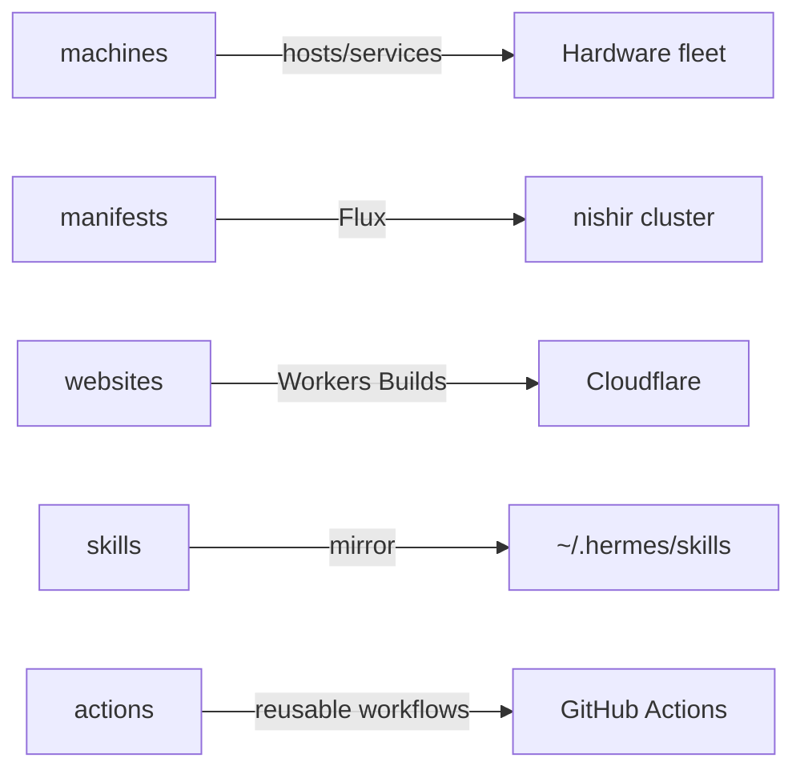

# Quick start

Zero-to-productive on the Shikanime Studio platform.

## Accounts and access

| What                | Where                                            |
| ------------------- | ------------------------------------------------ |
| GitHub orgs         | `shikanime-labs`, `shikanime-studio`             |
| Identity provider   | Authelia OIDC SSO backed by LLDAP                 |
| Secrets             | sops-nix (`*.enc.yaml`) fleet-wide, Vaultwarden for interactive use |
| Cluster access      | Tailscale + kubeconfig from the leader           |
| Agent credentials   | sops `hermes-agent-a2a-token-<peer>` per host    |

## Prerequisites

Four tools gate access to the repos. **jj** (Jujutsu) comes first: all
repos are jj-managed, and bare git commits will fight the tooling.
**Nix** with flakes is next — every repo has a `flake.nix` and a devenv
shell (`nix develop`). The websites monorepo needs **pnpm ≥ 10**.
Finally, **Tailscale** membership in the tailnet.

## The repos you touch daily

## Daily loop

1. **Pick work**: the Shikanime Studio project board's rightmost active
   column is the tactical plan.
2. **Branch**: fresh jj workspace pinned to `main@origin` — never work in
   the shared checkout.
3. **Verify**: `nix fmt` scoped, `pnpm lint`, `pnpm build` as
   applicable.
4. **Land**: push branch → PR → CI green → squash merge. A verbal lgtm
   is the approval signal.
5. **Deploy happens by Git**: Flux reconciles manifests. Workers Builds
   deploys `main` of websites.

## Conventions that will bite you

Commits use a plain capitalized title, no conventional-commit prefix.
Agent-assisted commits carry the Automata co-author trailer. `manifests`
and `skills` require `Signed-off-by` (gitlint CC1).

Markdown wraps at 80 columns. `nix fmt` runs scoped
(`nix fmt apps/<app>`). A whole-tree run dirties ~64 files.

jj does not auto-track bookmarks — `jj bookmark track <branch>`
--remote=origin` before every push.

Docusaurus apps must NOT set `"type": "module"` in package.json.
webpack mis-parses the codegen and the SSG build crashes.
