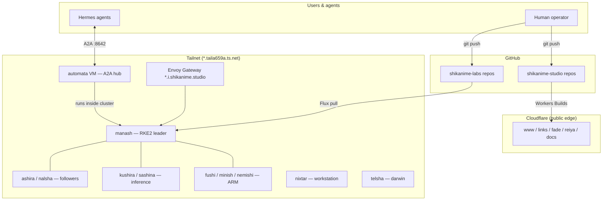

# Introduction

This handbook documents the Shikanime platform **from zero**: who we are,
what hardware runs it, how it is configured, what services it hosts, and
how agents automate it. Every claim here is sourced from the actual
repositories — `machines`, `manifests`, `websites`, `skills`, `actions`.

## The 30-second version

Shikanime is a personal platform operated by one engineer and a fleet of
AI agents:

- **Two GitHub orgs** — Studio (public web) and Labs (infrastructure)
- **Eleven Nix-managed hosts** — x86 minis, Raspberry Pis, two Strix Halo
  inference nodes, a laptop, a Mac, one KubeVirt VM
- **One RKE2 cluster** (`nishir`) declaratively managed by Flux from Git
- **Dozens of self-hosted services** — media, identity, git forge, Matrix,
  local LLM inference
- **An agent mesh** — Hermes Agent instances on every host, peered over
  the tailnet via A2A, with a KubeVirt VM (`automata`) as hub
- **Web properties on Cloudflare Workers** — Astro and Docusaurus apps in
  a pnpm monorepo

Everything described here lives in version control:

| Concern        | Repository                                     |
| -------------- | ---------------------------------------------- |
| Machines (Nix) | `shikanime-labs/machines`                      |
| Cluster apps   | `shikanime-labs/manifests`                     |
| Web properties | `shikanime-studio/websites`                    |
| Agent skills   | `shikanime-labs/skills`                        |
| Org automation | `shikanime-labs/actions`                       |
| Grafana boards | `shikanime-labs/dashboards`                    |

## System map

## Reading order

1. **Platform** — the orgs, the repos, the public web properties, getting
   started
2. **Infrastructure** — the metal, the Nix fleet, the clusters, the
   tailnet
3. **Services** — what actually runs: media, identity, forge, inference
4. **Automation** — Hermes agents, the A2A mesh, CI, and repo hygiene
