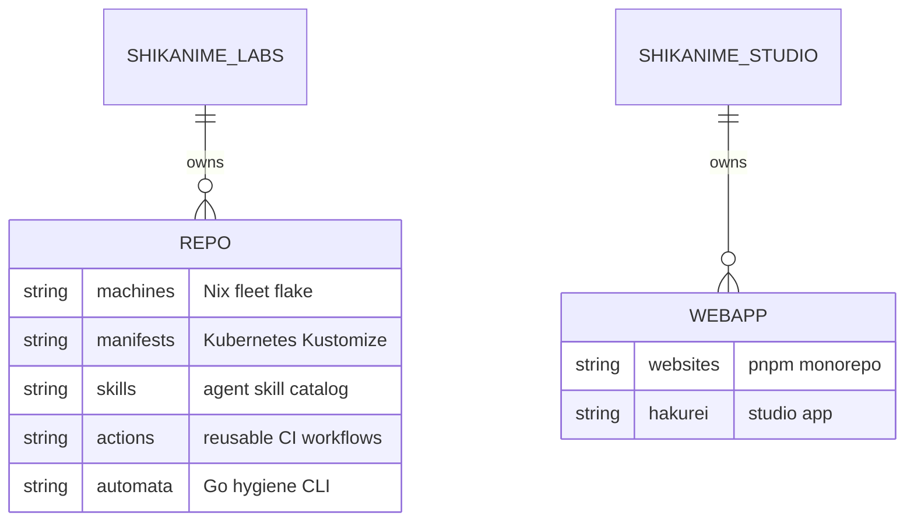
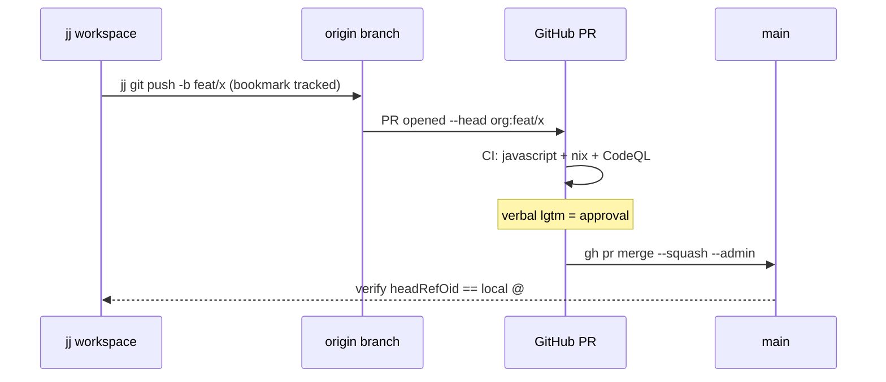

# Overview

Shikanime Studio operates as two GitHub organizations with a shared
identity. **Shikanime Studio** (`shikanime-studio`) is the public-facing
side: web properties and product work. It owns the `websites` monorepo.
**Shikanime Labs** (`shikanime-labs`) covers infrastructure, tooling,
and automation. It owns `machines`, `manifests`, `skills`, `actions`,
`dashboards`, `tailnet`, `knix`, `wharf`, `niximgs`, `automata`,
`enhancements`, and more.

Cross-org proposals are tracked KEP-style in `shikanime-labs/enhancements`.

Repositories are managed with the Jujutsu version-control tool **jj** —
not bare git. Working
branches push to `origin` and land via squash-merge PRs. `main` is
protected in both orgs.

## Organization schema

## Repository map

| Repository                  | Purpose                                                     |
| --------------------------- | ----------------------------------------------------------- |
| `machines`                  | NixOS / nix-darwin fleet configuration (flake)              |
| `manifests`                 | Kubernetes manifests, Kustomize apps + clusters             |
| `websites`                  | pnpm monorepo of web apps, this docs site included          |
| `skills`                    | Curated agent-skill catalog for Hermes agents               |
| `actions`                   | Reusable GitHub Actions workflows                           |
| `dashboards`                | Grafana dashboards, pinned by tag in manifests              |
| `automata`                  | Go CLI for kustomize/Actions version hygiene                |
| `knix`                      | Opinionated RKE2 deployment module (Kubernetes + Nix)       |
| `wharf`                     | Build OCI images from Nix flakes                            |
| `niximgs`                   | Nix-built container image registry (Bitnami-style)          |
| `tailnet` / `tailscale-gateway` | Tailnet configuration and gateway wiring                |
| `enhancements`              | Cross-org KEP-style proposals and tracking                  |
| `identities`                | Identity management module                                  |
| `devlib`                    | Shared development modules (devenv, treefmt)                |
| `documentation`             | General documentation collection                            |

## Conventions

The languages are fixed: TypeScript for web, Nix for fleet and
packages, Go for CLI tooling, YAML for manifests.

Commits use plain capitalized titles, no conventional-commit prefix.
Agent-assisted commits carry the Automata co-author trailer
(`automata@shikanime.studio`). `manifests` and `skills` additionally
require `Signed-off-by` (gitlint CC1).

Run `nix fmt` (treefmt) before shipping. Markdown wraps at 80 columns.
Landing is PR + squash, and a verbal lgtm is the approval signal.

## Landing flow

