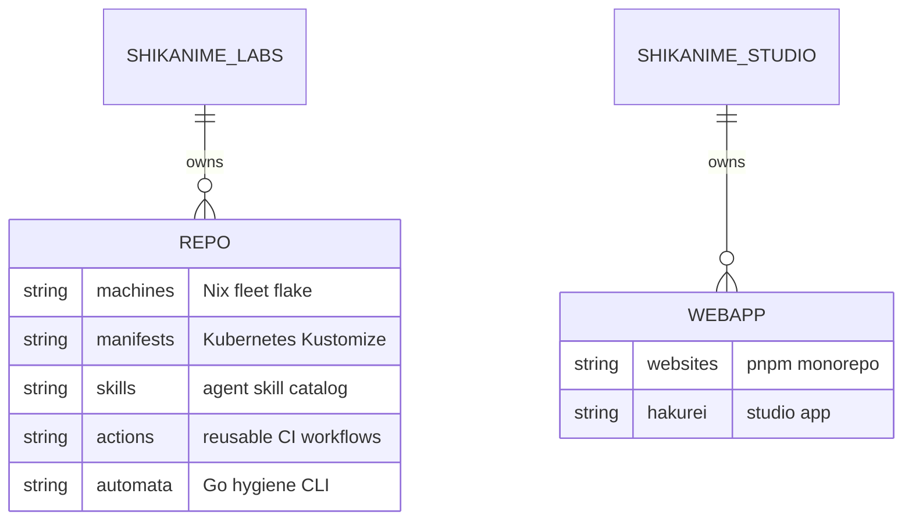
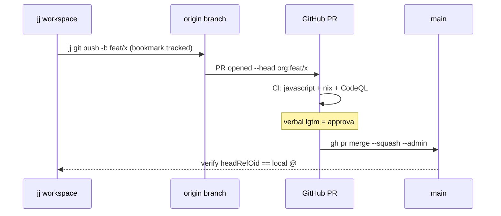

# Overview

Shikanime operates as two GitHub organizations with a shared identity:

- **Shikanime Studio** (`shikanime-studio`) — public-facing web properties
  and product work. Owns the `websites` monorepo.
- **Shikanime Labs** (`shikanime-labs`) — infrastructure, tooling, and
  automation. Owns `machines`, `manifests`, `skills`, `actions`,
  `dashboards`, `tailnet`, `knix`, `wharf`, `niximgs`, `automata`,
  `platform-api`, `enhancements`, and more.

Cross-org proposals are tracked KEP-style in `shikanime-labs/enhancements`.

Checkouts live at `~/Source/Repos/github.com/<org>/<repo>` and are managed
with **jj** (Jujutsu) — not bare git. Working branches push to `origin`
and land via squash-merge PRs; `main` is protected in both orgs.

## Organization schema

## Repository map

| Repository                  | Purpose                                                     |
| --------------------------- | ----------------------------------------------------------- |
| `machines`                  | NixOS / nix-darwin fleet configuration (flake)              |
| `manifests`                 | Kubernetes manifests, Kustomize apps + clusters             |
| `websites`                  | pnpm monorepo of web apps (this docs site included)         |
| `skills`                    | Curated agent-skill catalog for Hermes agents               |
| `actions`                   | Reusable GitHub Actions workflows                           |
| `dashboards`                | Grafana dashboards, pinned by tag in manifests              |
| `automata`                  | Go CLI for kustomize/Actions version hygiene                |
| `knix`                      | Opinionated RKE2 deployment module (Kubernetes + Nix)       |
| `wharf`                     | Build OCI images from Nix flakes                            |
| `niximgs`                   | Nix-built container image registry (Bitnami-style)          |
| `tailnet` / `tailscale-gateway` | Tailnet configuration and gateway wiring                |
| `platform-api`              | CRD-oriented DevSecOps platform trunk, Cluster API provider  |
| `cloud-pi-native-core`      | Alchemy v2 infrastructure library (`Cpn.<Svc>.<Res>`)      |
| `enhancements`              | Cross-org KEP-style proposals and tracking                  |
| `identities`                | Identity management module                                  |
| `devlib`                    | Shared development modules (devenv, treefmt)                |
| `documentation`             | General documentation collection                            |

## Conventions

- **Language**: TypeScript for web, Nix for fleet and packages, Go for CLI
  tooling, YAML for manifests.
- **Commits**: plain capitalized titles, no conventional-commit prefix.
  Agent-assisted commits carry the Automata co-author trailer
  (`automata@shikanime.studio`); `manifests` and `skills` additionally
  require `Signed-off-by` (gitlint CC1).
- **Formatting**: `nix fmt` (treefmt) before shipping; Markdown wraps at 80
  columns.
- **Landing**: PR + squash; verbal lgtm is the approval signal.

## Landing flow

