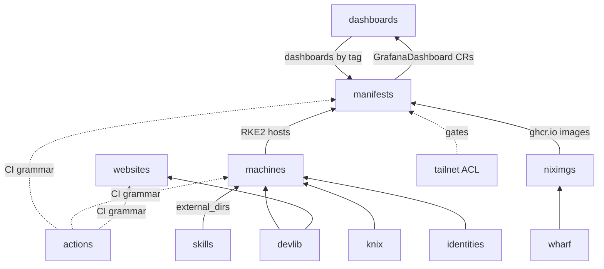

# Repository catalog

Every repository in both orgs, grouped by layer.

## Infrastructure — shikanime-labs

| Repo         | Purpose                                                        |
| ------------ | -------------------------------------------------------------- |
| `machines`   | Source of truth for all 11 hosts: NixOS, nix-darwin, Home Manager, sops secrets; deploys via comin |
| `manifests`  | All cluster state: Kustomize trees for 32 apps / 20 operators, reconciled by Flux onto nishir/telsha |
| `tailnet`    | GitOps for the tailnet ACL (`policy.hujson`, HuJSON) — tests on PR, apply on merge, no stored keys |
| `knix`       | Opinionated NixOS module set that bootstraps the RKE2 cluster (`services.knix.*`: rke2, canal, coredns, flux, longhorn, multus) |
| `wharf`      | Go CLI building OCI images from Nix flakes; multi-platform + registry push; the Skaffold custom builder |
| `niximgs`    | Bitnami-style image registry from nixpkgs → `ghcr.io/shikanime/<app>` for jellyfin, postgresql, radarr, sonarr, syncthing, vaultwarden, whisparr, and mlflow |
| `dashboards` | Grafana dashboard JSON pulled by grafana-operator at pinned tags for blackbox, blocky, halogen-flash, and llama-cpp |
| `identities` | Persona data — name, email, signing keys — in sops; emits git includes + jj conf.d fragments for 3 personas: shikanime, gouv, automata |

## Products — shikanime-studio

| Repo       | Purpose                                                          |
| ---------- | ---------------------------------------------------------------- |
| `websites` | The pnpm monorepo: www, links, reiya, fade, docs, plus accounts in flight, on Cloudflare Workers — see [Web properties](../products/web-properties) |
| `hakurei`  | The Touhou MMO: deterministic Rust core, authoritative gRPC server, Bevy thin client — see [Hakurei](../products/hakurei) |
| `tailscale-gateway` | Kubernetes controller wiring Gateway API → Tailscale Serve |

## Automation & tooling — shikanime-labs

| Repo                | Purpose                                                       |
| ------------------- | ------------------------------------------------------------- |
| `skills`            | The agent skill catalog — see [Skills catalog](../automation/skills) |
| `actions`           | Reusable actions + org workflows: `.land`/`.rebase`/`.close`/`.backport` comment commands, nix/pnpm/skaffold/flux integration actions |
| `automata`          | Go CLI for repo/cluster hygiene: kustomize image tags, workflow bumps, `update.sh`, flake/k0sctl updates |
| `devlib`            | Nix flake-module library: devenv profiles for nix, rust, python, and more; home modules; workflow/config generators for ghstack, sops, renovate, and more |
| `minishells`        | Per-org dev shells for the cloud-pi-native family, over devlib |
| `xqbit`             | qBittorrent hygiene via `qbittorrent-cleanup`, which reaps missing/errored torrents |

## Process & personal

| Repo       | Purpose                                                        |
| ---------- | -------------------------------------------------------------- |
| `enhancements` | Cross-org KEP-style SEP process (`seps/<org>/NNNN-*/sep.yaml`); freshly scaffolded |
| `colemak`  | Colemak layout Nix modules; NEUI-cluster navigation keymaps for helix/zed/neovim |
| `dotfiles` | chezmoi + Nix personal config, including Hermes agent config    |
| `algorithm` | Algorithm challenges in C++/Elixir/JS/OCaml/Python              |
| `gitignore` | .gitignore templates for Astro, Devenv, MLflow, Wrangler, and LaTeX |
| `.github` (×2) | Org profiles and community health files for both orgs        |

## The dependency spine

