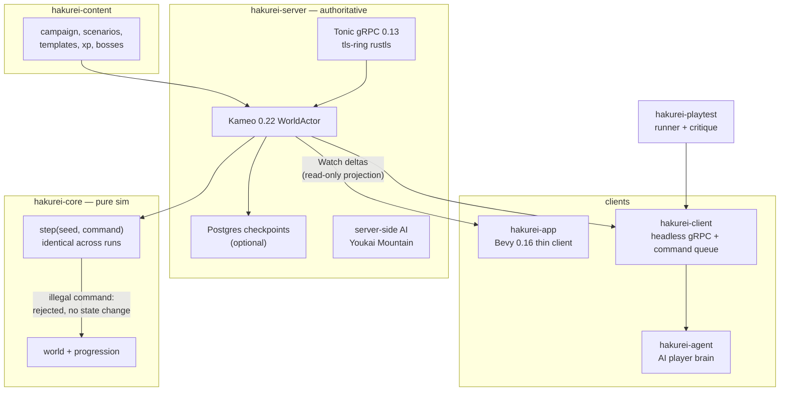

# Hakurei — the MMO

`shikanime-studio/hakurei` is the flagship product: a **single-universe
Touhou MMO with Dofus-like tactical combat** — every player shares one
Gensokyo. Current state: **playable 2v2 skirmish**.

## Architecture

A Cargo workspace (`resolver = 3`) of seven crates with one hard rule:
**the simulation is deterministic and pure**, everything else is a
projection of it.

| Crate            | Role                                                   |
| ---------------- | ------------------------------------------------------ |
| `hakurei-core`   | deterministic sim; `step(seed, command)` is pure; illegal commands leave state untouched (ADR-002) |
| `hakurei-server` | authoritative Tonic gRPC server; Kameo `WorldActor`; axum; optional Postgres checkpoints (ADR-004); server-side AI |
| `hakurei-app`    | Bevy 0.16 2D **thin client** — renders a read-only projection driven by Watch deltas (ADR-005): camera, unit panel, spellbook, turn strip, damage popups |
| `hakurei-client` | headless shared gRPC client + world projection + command queue, no winit/GPU — consumed by the renderer *and* agent brains |
| `hakurei-content`| campaign, scenarios, templates, XP, boss attachments such as Meiling |
| `hakurei-agent`  | AI player: brain, policy, vision_brain, gateway        |
| `hakurei-playtest`| playtest runner + critique loop                       |

## Game model

- 10×10 **isometric grid**, Chebyshev-distance range
- AoE shapes: single / cross / radius
- Per-turn **AP/MP budgets**, a Dofus-style action economy
- Character kits: Reimu, Marisa, Cirno

## Engineering

- Design docs in `docs/design/` (NORTH-STAR, GDD, architecture,
  data-model, characters, roadmap, KPI, QA). Decisions live in
  `docs/adr/`: ADR-002 determinism, ADR-004 checkpoints, ADR-005
  projection client. Agent instructions live in `docs/agents/`
- Tests: `cargo test --workspace --exclude hakurei-server`, `e2e_watch`
  against a live server, `nix flake check --impure`
- Governance: DCO `Signed-off-by`, linear **signed** squash-rebase
  `main`, Apache-2.0 © Shikanime Deva; Touhou © ZUN / Team Shanghai
  Alice
- A landing page at `hakurei.shikanime.studio`, built with Astro,
  existed in the `websites` monorepo and was removed. Only the MMO repo
  remains
