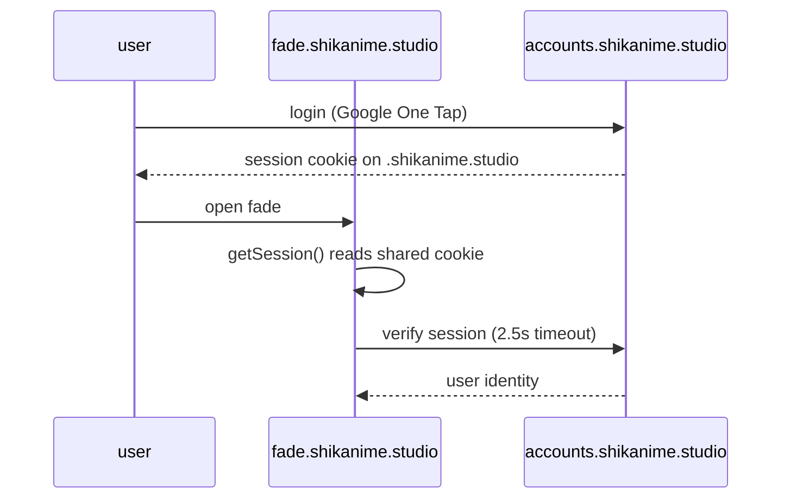

# Identity mesh (web SSO)

The web properties are moving from per-app auth to a **central identity
provider**: the `accounts` app, in flight as
[PR #366](https://github.com/shikanime-studio/websites/pull/366)
(branch `feat/accounts-sso`, stacked PRs #306–#327). This is separate
from the fleet-side SSO (Authelia/LDAP — see
[Cluster services](../services/catalog)): the web mesh is
better-auth based and scoped to `*.shikanime.studio`.

## accounts — OIDC provider

`apps/accounts` (TanStack Start + better-auth on D1) at
`accounts.shikanime.studio`:

- **better-auth `oauthProvider` plugin** — full OIDC: scopes
  `openid profile email offline_access`, grants
  `authorization_code` + `refresh_token`; code 600 s, access 3600 s,
  refresh 30 d
- **jwt plugin** issuing from `${VITE_SITE}/api/auth`; Google One Tap +
  social login
- Drizzle schema on D1 (`accounts` database): `user`, `session`,
  `account`, `verification`, `rate_limits`, `jwks`, plus the OAuth
  tables (`oauth_client`, `oauth_access_token`, `oauth_refresh_token`,
  `oauth_consents`, client assertions/resources)
- Routes: `login`, `consent` (the OAuth consent screen), `api/auth/$`
  handler

## auth-shared — session reader

`packages/auth-shared` (same PR stack) gives every sibling app a
one-call session read across subdomains:

- `SESSION_COOKIE_NAME` (`better-auth.session_token`),
  `getSessionToken()` raw cookie extractor
- `getSession()` resolves the signed-in user from the shared
  `.shikanime.studio` cookie against the accounts IdP
  (`https://accounts.shikanime.studio`, 2500 ms timeout)
- Consumed by `fade`, `links`, `www` (PRs #322/#324/#342)

## reiya — first consumer

`reiya` already runs better-auth standalone (passkeys via
`@better-auth/passkey`, Google One Tap, drizzle on D1). The mesh unifies
this: reiya is being re-wired as a generic OAuth client of accounts
(PR #315), with an OIDC regression harness (PR #316).

## Stack notes

- The PR stack was originally ghstack-shaped but the `orig` refs are
  broken on the remote — new work stacks as plain PRs with
  `--base gh/shikanime/<tip#>/base`; GitHub retargets to `main` as
  lower PRs land
- `apps/accounts` is **not on main** — every main Workers build of it
  fails `root directory not found` until #366 lands; the other four apps
  deploy cleanly from `main`
