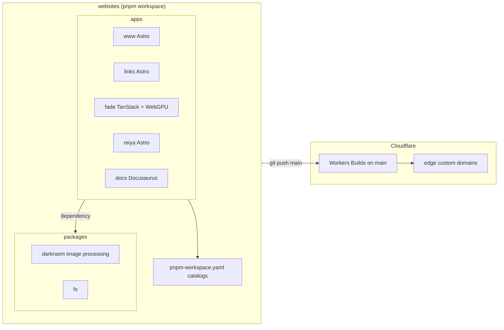

# Web properties

All public web properties live in the `shikanime-studio/websites` pnpm
monorepo and deploy to **Cloudflare Workers** via git integration on
`main`, using Workers Builds. Each app has its own `wrangler.jsonc`.

| App     | URL                            | Stack                                  |
| ------- | ------------------------------ | -------------------------------------- |
| `www`   | shikanime.studio               | Astro 6, Cloudflare, Tailwind 4        |
| `links` | links.shikanime.studio         | Astro, link hub / landing page         |
| `fade`  | fade.shikanime.studio          | Local WebGPU image viewer (TanStack)   |
| `reiya` | reiya.shikanime.studio         | Merch / community site (Astro)         |
| `docs`  | this site                      | Docusaurus 3, Workers assets, manual wrangler deploy |

## Monorepo schema

## Dependency catalogs

Versions are centralized in `pnpm-workspace.yaml` catalogs — an ESLint
rule enforces it, so apps never pin plain specifiers:

| Catalog    | Holds                                                    |
| ---------- | -------------------------------------------------------- |
| `build`    | astro, vite, tailwind, lightningcss, sharp, cloudflare adapters |
| `runtime`  | react, tanstack, better-auth, docusaurus, zod            |
| `lint`     | @antfu/eslint-config, eslint plugins                     |
| `types`    | typescript, @types/*                                     |
| `test`     | vitest, playwright                                       |
| `script`   | tsx, drizzle-kit, better-sqlite3                         |

`trustPolicy: no-downgrade` blocks packages whose newer version lost
provenance evidence. Exceptions are explicit in `trustPolicyExclude`.

## CI and deploy

CI runs `pnpm/integration` — check, lint, build — plus a treefmt gate.
Deploy is push-to-main → Workers Builds. Verify a deploy by the build
log's `Uploaded`/`Deployed` lines — never by the green check alone. A
wrong path filter exits green while building nothing. Filter by
package name `--filter @shikanime-studio/<x>`, not directory.

