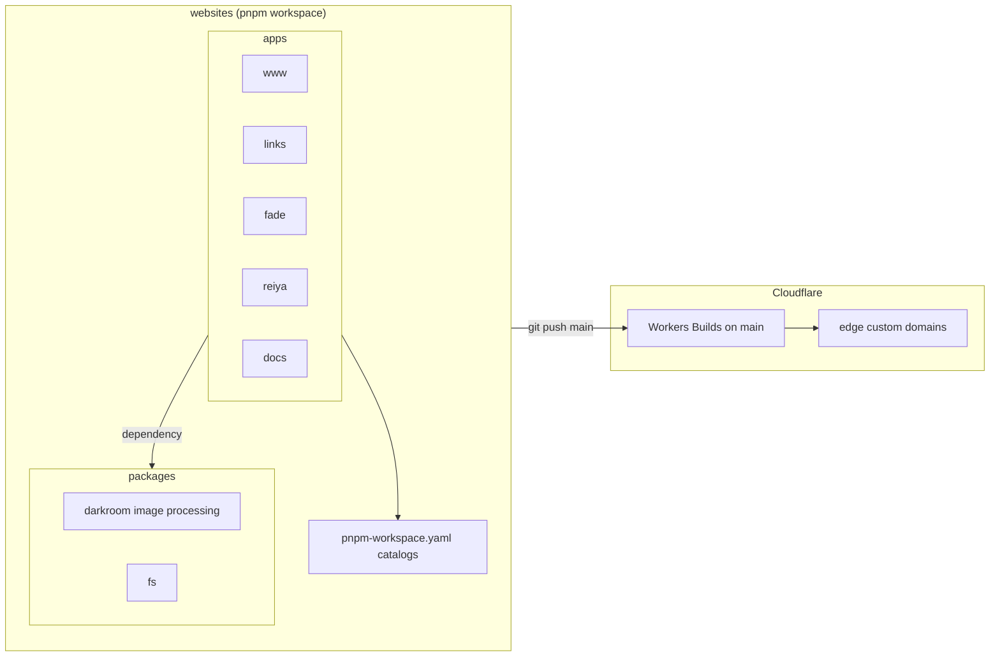
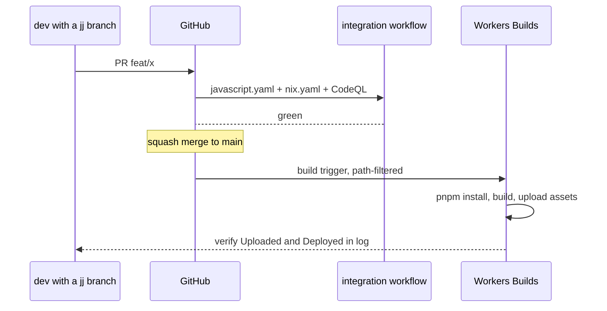

# Products

Shikanime Studio ships five public products, all built in the
`shikanime-studio/websites` pnpm monorepo and served by Cloudflare.

| Product  | URL                      | What it is                          | Stack                |
| -------- | ------------------------ | ----------------------------------- | -------------------- |
| www      | shikanime.studio         | Studio site                         | Astro 6, Tailwind 4  |
| links    | links.shikanime.studio   | Link hub                            | Astro                |
| fade     | fade.shikanime.studio    | Image viewer, WebGPU                | TanStack Start       |
| reiya    | reiya.shikanime.studio   | Merch and community                 | TanStack Start, D1   |
| docs     | docs.shikanime.studio    | This book                           | Docusaurus 3         |

Every app has its own `wrangler.jsonc`. Four apps deploy through
Workers Builds on merge to `main`. The docs app deploys by a manual
`wrangler deploy` because it has no Builds configuration yet.

## The other two products

Two products live outside this table:

| Product  | Where                               | What it is                               |
| -------- | ----------------------------------- | ---------------------------------------- |
| hakurei  | `shikanime-studio/hakurei` repo     | The MMO — see [Hakurei](./hakurei)      |
| accounts | `websites` branch feat/accounts-sso  | The SSO provider — see [Identity mesh](./identity-mesh) |

## Monorepo schema

## Dependency catalogs

Versions are centralized in `pnpm-workspace.yaml` catalogs — an ESLint
rule enforces it, so apps never pin plain specifiers:

| Catalog   | Holds                                                         |
| --------- | ------------------------------------------------------------- |
| `build`   | astro, vite, tailwind, lightningcss, sharp, cloudflare adapters |
| `runtime` | react, tanstack, better-auth, docusaurus, zod                 |
| `lint`    | @antfu/eslint-config, eslint plugins                          |
| `types`   | typescript, @types/*                                          |
| `test`    | vitest, playwright                                            |
| `script`  | tsx, drizzle-kit, better-sqlite3                              |

`trustPolicy: no-downgrade` blocks packages whose newer version lost
provenance evidence. Exceptions are explicit in `trustPolicyExclude`.

## CI and deploy

CI runs `pnpm/integration` — check, lint, build — plus a treefmt gate.
Verify a deploy by the build log's `Uploaded`/`Deployed` lines — never
by the green check alone. A wrong path filter exits green while
building nothing. Filter by package name `--filter
@shikanime-studio/<x>`, not directory.

