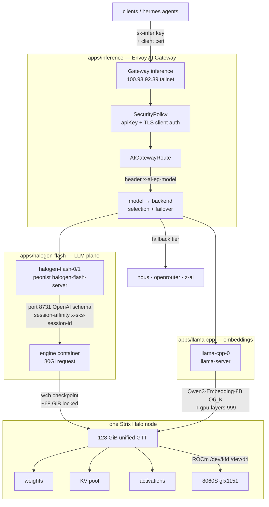

# AI infrastructure

The inference plane is the most engineered corner of the platform: two
consumer mini PCs with laptop-class iGPUs serve frontier-scale quantized
models locally, fronted by an mTLS gateway that can fall back to remote
providers. This page follows one request from silicon to tokens — and
records why each layer exists.

## Hardware floor

| Fact                | Value                                             |
| ------------------- | ------------------------------------------------- |
| Nodes               | `kushira`, `sashina` — Minisforum MS-S1 Max       |
| APU                 | AMD Strix Halo, Radeon 8060S iGPU (gfx1151)       |
| Memory              | 128 GiB LPDDR5X **unified**, no VRAM split       |
| GPU memory model    | GTT, the Graphics Translation Table — GPU shares host RAM |
| Allocatable to k8s  | ~116 GiB per node of a 125 GiB capacity          |
| Scheduling label    | `node.kubernetes.io/instance-type: minisforum-ms-s1` |

The single design fact everything else derives from: **unified memory**.
The 8060S and the CPU share one 128 GiB GTT pool, so "VRAM" is a
policy decision, not a hardware boundary. A model that fits RAM can be
served. Anything else must be quantized or routed elsewhere.

## Serving path — live shape, Oct 2026

## Memory dataflow, layer by layer

1. **Weights arrive** via an init prefetch into a local-path PVC
   (`cache-huggingface`, 128–256 GiB) — `qwen38-flash-next-w4b.hgn`
   is 115.5 GiB including the multi-token-prediction MTP sidecar and
   tokenizer. The engine
   container itself makes **no outbound connections**. No runtime
   downloads happen. The cache claim is mounted at the default HF path.
2. **Weights lock** ~68 GiB of the node's unified memory from the w4b
   checkpoint plus the KV pool reservation. The k8s memory request is 80 GiB
   so the scheduler reserves practically the whole node. VPA was scoped
   to CPU only in #2711 — memory is pinned, not autoscaled. One engine
   per node: `podAntiAffinity` on `kubernetes.io/hostname` across the
   2-replica StatefulSet.
3. **Decode** runs on the iGPU over ROCm (`/dev/kfd`, `/dev/dri`
   device mounts). Unified memory means zero host→device copies: the
   GPU dereferences host RAM directly.
4. **KV cache** shares what weights leave free — context length and
   concurrency trade directly against model size inside one pool.
   Sessions are pinned to a pod via `x-sks-session-id` header affinity
   (`BackendTrafficPolicy halogen-flash-affinity`) so a conversation's
   KV stays warm on the node that built it.
5. **Requests** enter through the tailnet-only Gateway VIP, present a
   client certificate — bare probes die at TLS with `000`, by design —
   plus a gateway-issued `sk-infer` key, and carry
   `x-ai-eg-model` for route selection.

## History: why this shape

- **Ollama era, 2024** — single-model serving on the cluster. PVs
  moved around by hand. First appearance of "GPU node" scheduling.
- **llama.cpp single node, 2025 to 2026** — `llama-server` per model,
  GGUFs prefetched by init containers into emptyDir. `models-preset.ini`
  maps gateway model names to local files.
- **RPC pair experiment, Sep 2026** — two llama.cpp processes bridged
  over RPC as `rpc-head` + `rpc-worker`, with macvlan `br1` attach and
  chunked prefill tuning, to pool both Halos for one model. Deep effort:
  health probes on pod IPs, cache on local-path, RPC-peer alerts.
  Verdict: workable but prefill-bound — long prompts starved decode.
- **halogen-flash cutover, Sep 30 in #2703** — peonist
  `halogen-flash-server` adopted from a live evaluation in #2701:
  **10–20× prefill, 3× decode, 13× lower TTFT** — time-to-first-token —
  **at 32K depth** vs the
  RPC baseline, on a *single* node. The RPC pair was removed the same
  day. Final removal landed Oct 6 in #2774. The route for
  `qwen/qwen3.8-flash` points at halogen with nous/openrouter as
  fallback tiers.
- **llama-cpp residual role, Oct 12 in #2875** — scaled to one
  replica, embeddings only (`qwen/qwen3-embedding-8b`, Q6_K,
  `n-gpu-layers 999` = fully offloaded to the iGPU). LLM serving is
  halogen's job now.

The lesson the platform took: on unified-memory APUs the bottleneck is
prefill bandwidth, not weight capacity — an engine built for the memory
model beats clustering general-purpose servers.

## Gateway plane (`apps/inference`)

- `Gateway/inference` (ns `shikanime`): client auth is API-key
  based — `SecurityPolicy/inference-apikey` checks gateway-issued keys
  from `Secret/inference-key`, one key per client identity. Upstream
  provider keys are NOT client credentials — they 401. TLS client-cert
  validation is configured on the EnvoyProxy listener plane.
- `AIGatewayRoute default`: `x-ai-eg-model` header → backend chain,
  each with `modelNameOverride`:
  `qwen/qwen3.8-flash` → halogen at priority p0 → nous → openrouter;
  `z-ai/glm-5.3-flash` → z-ai-openai → nous;
  `qwen/qwen3-embedding-8b` → llama-cpp → nous → openrouter.
  A catch-all `.*` route and further model routes for mistral and
  glm-5.3 exist — read `aigatewayroute.yaml` for the live table.
- `Backend`/`AIServiceBackend` CRs resolve each tier: halogen via
  headless svc :8731. Remote providers use their own key-injecting
  `BackendSecurityPolicy`s.
- Timeouts: `AIGatewayRoute` rules set `request: 0s`, disabled —
  generation length is unbounded at the route. The llama-cpp HTTPRoutes
  carry the 600 s cap instead.
- Known edges: `/mcp/z-ai` 500s from an ai-gateway v1.1.0 MCP header
  gap, tracked in manifests#1894. Anthropic-schema backends are only
  reachable via `/anthropic/v1/messages`. There is no
  OpenAI-to-Anthropic translation.

## Observability

VMServiceScrape on halogen `/metrics` (60 s), `HalogenFlashDown`
VMRule, llama-cpp dashboard re-pinned, Envoy dataplane SLI rules with
gateway-name relabeling — the inference plane is fully on the fleet
dashboard stack (see [Observability](./observability)).
