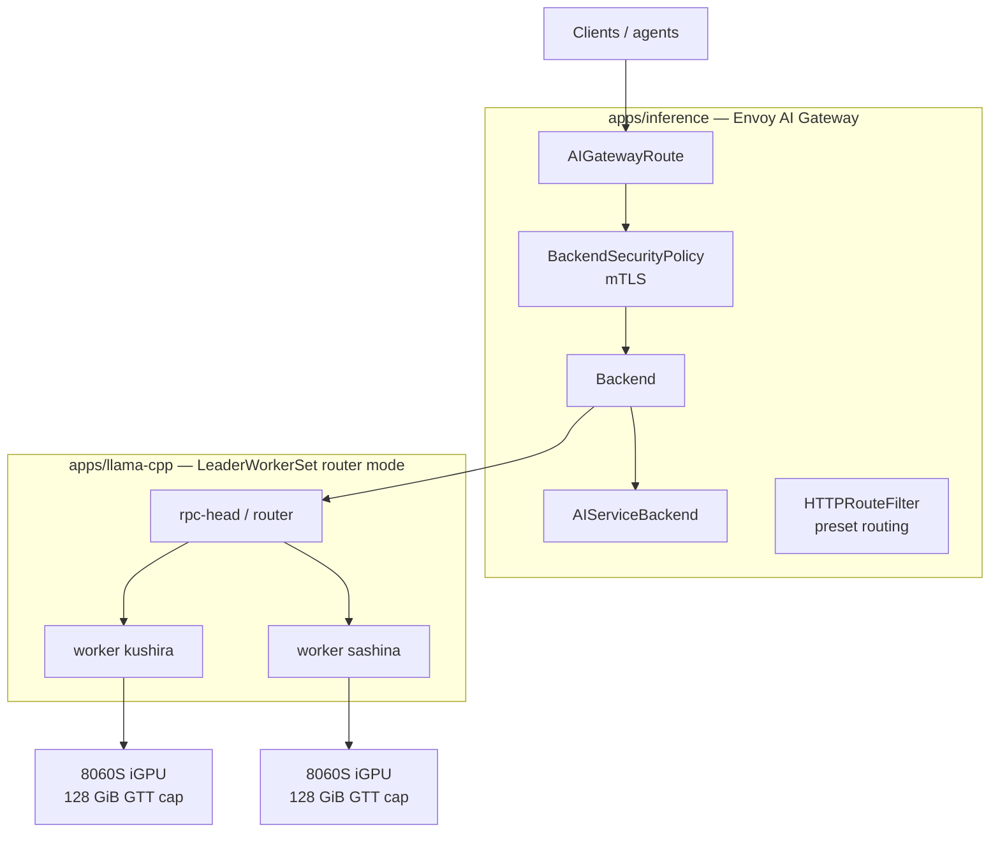
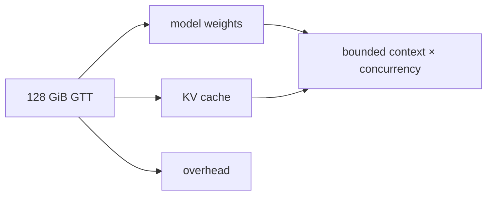

# Inference platform

Local LLM inference runs on the two **Strix Halo** nodes (`kushira`,
`sashina` — Minisforum MS-S1 Max, AMD Radeon 8060S iGPU, gfx1151).

## Serving path

- **`apps/inference`** — Envoy AI Gateway fronting the inference plane with
  mTLS; a bare probe returns `000` **by design** (mTLS is required). CRs:
  `AIGatewayRoute`, `AIServiceBackend`, `Backend`,
  `BackendSecurityPolicy`, `HTTPRoute`, `HTTPRouteFilter`.
- **`apps/llama-cpp`** — llama.cpp in LeaderWorkerSet (LWS) router mode;
  capacity is bounded by the Halo nodes' memory (the 128 GiB GTT cap
  bounds model/KV headroom).
- Model selection and preset wiring live in a ConfigMap consumed by the
  gateway (`Backend` / `AIServiceBackend` CRs).

## Capacity model

The binding constraint is unified GTT memory shared between weights and
KV cache: bigger context or more concurrent sessions trades directly
against model size. Measure VRAM/KV headroom before routing new presets.

## Ops notes

- OOMKilled `rpc-head`/`strict-local` pods on llama.cpp: recover per the
  runbook (drop caches, restart, verify KV headroom before re-routing).
- HF-cache download wedges in router mode: clear the cache and re-pull.
- Strix Halo nodes also serve as `build-x86` remote builders when idle.
