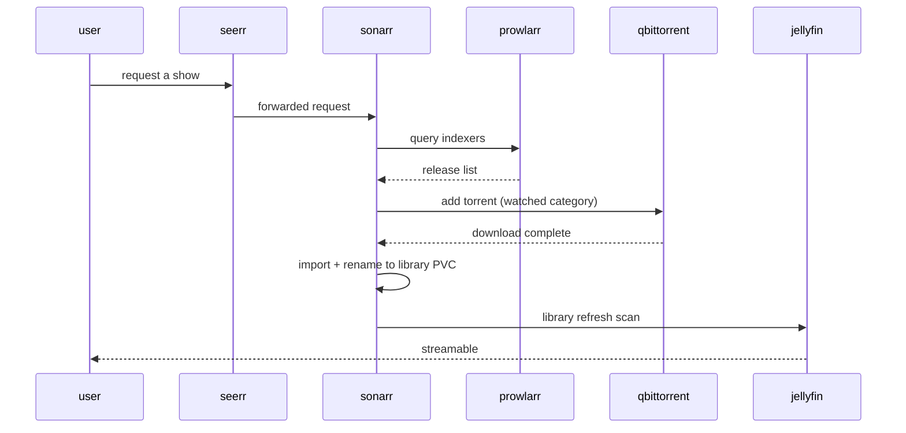

# Media pipeline

The `shikanime` namespace runs a full self-hosted media stack. The
pipeline is index → acquire → organize → serve, glued by shared
storage.

## Stages

| Stage       | Services                                              |
| ----------- | ----------------------------------------------------- |
| Index       | `prowlarr` (indexer aggregation/proxy)                 |
| Request     | `seerr` (requests), `sonarr`/`radarr`/`whisparr`/`lidarr` (TV/film/adult/music) |
| Acquire     | `qbittorrent` + `xqbit` cleanup sidecar               |
| Enrich      | `bazarr` (subtitles), `metatube` (metadata), `maintainerr` (library hygiene) |
| Serve       | `jellyfin` (media), `immich` (+ml, +postgres, +valkey) for photos |

## Servarr wiring

- The *arr apps own the library layout; jellyfin only reads it.
- Downloads land on host paths (`/mnt/patchouli`), libraries on
  Longhorn PVCs — the import step is the boundary.
- `xqbit` (`qbittorrent-cleanup`) runs as a sidecar loop: reaps
  `missingFiles` torrents and resumes recoverable errored ones
  (config via `QBT_URL`/`QBT_USER`/`QBT_PASSWORD`).

## Images

Most media images come from the org's own registry —
`ghcr.io/shikanime/<app>` built from nixpkgs via
[`niximgs`](https://github.com/shikanime-labs/niximgs) (jellyfin,
radarr, sonarr, whisparr, syncthing, vaultwarden, postgresql, mlflow),
built with [`wharf`](https://github.com/shikanime-labs/wharf) as the
Skaffold custom builder. Manifests pin them by digest; Renovate bumps
via image updates.

## Photos: immich

`immich` deploys as a set: the server, `immich-ml` (machine-learning
tagging/face detection), `immich-postgres`, `immich-valkey` (cache).
Uploads flow app → postgres metadata + object storage on PVC; ML jobs
run async through the valkey queue.
