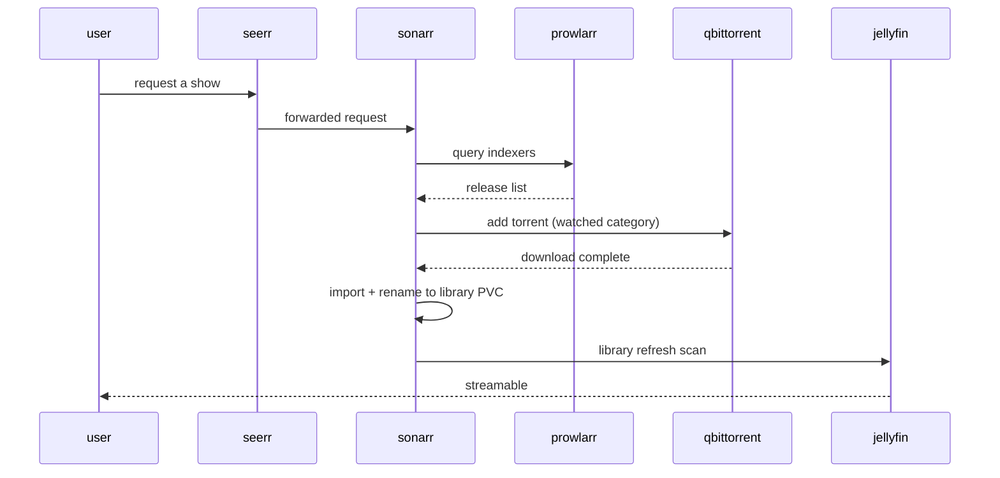

# Media pipeline

The `shikanime` namespace runs a full self-hosted media stack. The
pipeline is index → acquire → organize → serve, glued by shared
storage.

## Stages

| Stage       | Services                                              |
| ----------- | ----------------------------------------------------- |
| Index       | `prowlarr`, the indexer aggregation and proxy layer   |
| Request     | `seerr` for requests; `sonarr`/`radarr`/`whisparr`/`lidarr` for TV, film, adult, and music |
| Acquire     | `qbittorrent` + `xqbit` cleanup sidecar               |
| Enrich      | `bazarr` for subtitles, `metatube` for metadata, `maintainerr` for library hygiene |
| Serve       | `jellyfin` for media; `immich` with +ml, +postgres, +valkey for photos |

## Servarr wiring

The *arr apps own the library layout. jellyfin only reads it. Downloads
land on host paths (`/mnt/patchouli`) while libraries sit on Longhorn
PVCs. The import step is the boundary between the two.

`xqbit` (`qbittorrent-cleanup`) runs as a sidecar loop: it reaps
`missingFiles` torrents and resumes recoverable errored ones. Config
comes via `QBT_URL`/`QBT_USER`/`QBT_PASSWORD`.

## Images

Most media images come from the org's own registry —
`ghcr.io/shikanime/<app>` built from nixpkgs via
[`niximgs`](https://github.com/shikanime-labs/niximgs) (jellyfin,
radarr, sonarr, whisparr, syncthing, vaultwarden, postgresql, mlflow),
built with [`wharf`](https://github.com/shikanime-labs/wharf) as the
Skaffold custom builder. Manifests pin them by digest. Renovate bumps
via image updates.

## Photos: immich

`immich` deploys as a set: the server, `immich-ml` for
machine-learning tagging and face detection, `immich-postgres`,
`immich-valkey` for cache. Uploads flow app → postgres metadata +
object storage on PVC. ML jobs run async through the valkey queue.
