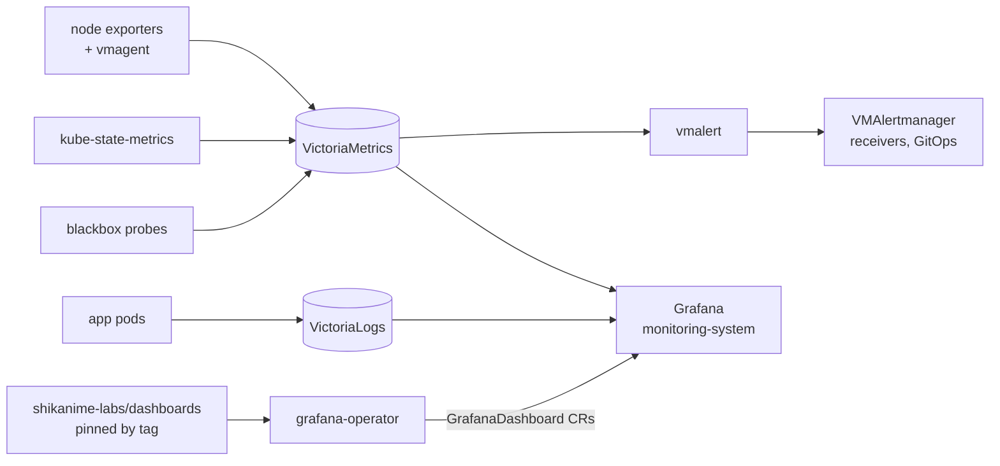

# Observability

The `nishir` cluster runs a full metrics + logs + dashboards stack in
`monitoring-system`, deployed by the manifests tree and fed by
agents on every node.

## Stack

| Component             | Role                                          |
| --------------------- | --------------------------------------------- |
| VictoriaMetrics (operator, vminsert ×2, vmagent, vmalert, vmauth) | metrics store + scraping + alert evaluation |
| VictoriaLogs (vlinsert, vlselect ×2) | log storage and LogsQL query |
| kube-state-metrics    | cluster-state metrics                         |
| Grafana + grafana-operator + grafana-image-renderer | dashboards as CRs, image rendering |
| blackbox              | SLO probes (deployed in `shikanime` ns)      |

## Dashboards as code

[`shikanime-labs/dashboards`](https://github.com/shikanime-labs/dashboards)
holds raw Grafana JSON (currently `blackbox`, `blocky`,
`halogen-flash`, `llama-cpp`). Conventions that keep the operator happy:

- stable kebab-case `uid`; tags include `shikanime` + topic tags
- `graphTooltip: 1` (crosshair sync), `editable: true`
- datasource via **template variable**, never a hardcoded uid
- nest under `dashboards/<topic>/` only when a topic needs multiple
  boards

Release flow: merge PR → tag `vX.Y.Z` → bump the pinned tag in the
consuming `GrafanaDashboard` CR `spec.url` in manifests. The operator
pulls from the repo by tag — no manual imports.

## Fleet alerts

Longhorn disk warnings are the classic false friend: the alert is
**snapshot-inclusive** free space — the 58 GiB eMMC nodes trip it while
raw usage is fine (recovery: nix gc or drop a disk). Alert routing is
declared in manifests (vmalert rules → VMAlertmanager receivers).
